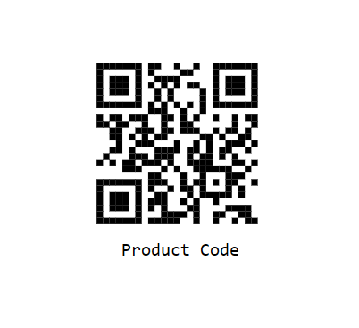
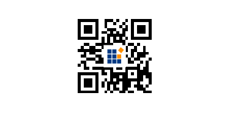

# QR Code Generator in Angular Barcode component

## QR Code Overview

A QR Code is a two-dimensional barcode that consists of a grid of dark and light dots or blocks that form a square. The data encoded in the barcode can be numeric, alphanumeric, or Shift Japanese Industrial Standards (JIS8) characters. The QR Code uses version from 1 to 40. Version 1 measures 21 modules x 21 modules, Version 2 measures 25 modules x 25 modules, and so on. The number of modules increases in steps of 4 modules per side up to Version 40 that measures 177 modules x 177 modules. Each version has its own capacity. By default, the barcode control automatically sets the version according to the length of the input text. The QR Codes are designed for industrial uses and are also commonly used in consumer advertising.










  


## Customizing QR Code Colors

A page or printed media with QR codes often appears colorful in the background and surrounding region with other contents. In such cases, the QR code can be customized to suit the design requirements. The foreground color of the QR code can be changed using the [`foreColor`](https://ej2.syncfusion.com/angular/documentation/api/barcode/barcodeGeneratorModel#forecolor) property.










  


## Customizing QR Code Dimensions

The dimensions of the QR code can be changed using the [`height`](https://ej2.syncfusion.com/angular/documentation/api/barcode/qRCodeLogoModel#height) and [`width`](https://ej2.syncfusion.com/angular/documentation/api/barcode/qRCodeLogoModel#width) properties of the QR code generator. These properties allow precise control over the QR code size to fit various design layouts and printing requirements.










  


### xDimension

The `xDimension` property sets the width and height, in pixels, of each square module of the QR Code. The default value is `1`. The value must be a finite number greater than `0`.

Use the `sizeMode` property to choose how `xDimension` is applied. It accepts the case-sensitive string values `'Fit'` or `'XDimension'`, and it has no default value.

- `Fit`: Uses the configured `xDimension` when the QR Code (including its quiet zone), the margins, and the display text area fit within the component's `width` and `height`. Otherwise, the value is reduced to the largest whole-pixel size that fits. The value is never enlarged to fill unused space, and the QR Code is centered in the available area. If not even 1 pixel per module fits, nothing is rendered and the `invalid` event is triggered.
- `XDimension`: Always uses the configured `xDimension`. The QR Code size is calculated from the module count (including the quiet zone) multiplied by `xDimension`. The QR Code is drawn from the top-left margin, is not centered, and the rendered area grows beyond `width` and `height` when the QR Code is larger.

`xDimension` based sizing is applied only when both `sizeMode` and `xDimension` are set. If either is omitted, the barcode is rendered using the configured `width` and `height`.

If `sizeMode` is set and `xDimension` is not a finite number greater than `0`, the `invalid` event is triggered with the message `Invalid xDimension` and the barcode is not drawn.

#### Fit the QR Code using xDimension

The following example sets `sizeMode` to `Fit`. The configured `xDimension` is kept when the symbol fits in the component; otherwise it is reduced to the largest whole-pixel size that fits.













#### Preserve the QR Code module size using xDimension

The following example sets `sizeMode` to `XDimension`. The configured `xDimension` is always used, and the rendered area grows if the symbol is larger than the configured `width` and `height`.













## Customizing Display Text

In QR code generators, the display text shown below the QR code can be customized using the  [`displayText`](https://ej2.syncfusion.com/angular/documentation/api/barcode/displayText#displaytext) property. This allows for user-friendly labels or alternative text representations of the encoded data.










  


## GS1 QR Code

GS1 QR Code is a special variant of the standard QR Code that encodes data using GS1 Application Identifiers (AIs). This enables supply chain data to be encoded in a standardized, machine-readable format. GS1 QR Codes include a GS1 prefix indicator and support multiple AIs within a single QR code, making them ideal for product identification, tracking, and information exchange in supply chain and retail environments.

Use the [`enableGS1`](https://ej2.syncfusion.com/angular/documentation/api/barcode/barcodeGeneratorModel#enablegs1) property on the [`QRCodeGenerator`](https://ej2.syncfusion.com/angular/documentation/api/barcode/qRCodeGenerator) to switch the control into GS1 mode.

**Allowed Input Characters:** GS1 QR Code supports numeric, alphabetic, and supported special characters. Data is encoded using GS1 Application Identifiers (AIs), allowing structured information such as product identifiers, batch numbers, expiration dates, serial numbers, and other business data to be stored within a single QR Code.













### GS1 QR Code with Error Correction

Combining GS1 encoding with error correction levels:













This configuration provides robust scanning even with partial damage to the QR code.

## Enhancing QR Codes with Logos

The Angular Barcode Generator enables adding a [`logo`](https://ej2.syncfusion.com/angular/documentation/api/barcode/qRCodeLogo#qrcodelogo) or icon to QR codes, enhancing their visual appeal, brand recognition, and authenticity. Adding a recognizable logo can make it easier for users to identify the source and can help establish trust and brand presence.

### Supported Image Sources
 
The [`imageSource`](https://ej2.syncfusion.com/angular/documentation/api/barcode/qRCodeLogo#imagesource) property of the `QRCodeLogo` class supports the following image sources:
 
- **Local image path**: Specify the path to the image file relative to the project's root directory (e.g., `images/syncfusion.png`) or as an absolute path (e.g., `/assets/icons/logo.svg`).
- **Remote image URL**: Provide the web address of the image file (e.g., `https://example.com/image.jpg`).
- **Base64 encoded image data**: Embed the image data directly in the code using a Base64-encoded string (e.g., `data:image/png;base64,iVBORw0KGgoAAAANSUhEUg...`).

### Logo Dimensions and Guidelines
 
The [`width`](https://ej2.syncfusion.com/angular/documentation/api/barcode/qRCodeLogo#width) and [`height`](https://ej2.syncfusion.com/angular/documentation/api/barcode/qRCodeLogo#height) properties of the `QRCodeLogo` class define the dimensions of the logo in pixels. If not specified, both default to 30% of the QR code's size. The maximum allowed size is 30% of the QR code's dimensions to ensure optimal readability and successful scanning.

**Important:** Always test the readability of QR codes after adding a logo. Depending on the logo size and QR code content complexity, it may be necessary to adjust the [`errorCorrectionLevel`](https://ej2.syncfusion.com/angular/documentation/api/barcode/errorCorrectionLevel) property of the `QRCodeGenerator` to `"Medium"` or `"High"` for better reliability and error recovery.

The following image illustrates a QR code with logo:










  
