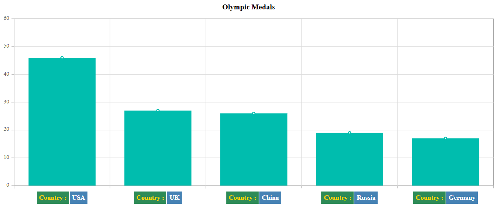

# Axis Labels in ASP.NET Core Charts

## Smart Axis Labels

When the axis labels overlap with each other, you can use [`labelIntersectAction`](https://help.syncfusion.com/cr/aspnetcore-js2/Syncfusion.EJ2.Charts.ChartAxis.html#Syncfusion_EJ2_Charts_ChartAxis_LabelIntersectAction) property in the axis, to place them smartly. This helps improve readability by automatically adjusting label visibility or orientation. The supported values are `None`, `Hide`, `Rotate45`, `Rotate90`, `Rotate45WithTrim`, `Rotate90WithTrim`, `Wrap`, `MultipleRows`, and `Trim`. The default value is `None`.

When `labelIntersectAction` is set to `Hide`










When `labelIntersectAction` is set to `Rotate45`










When `labelIntersectAction` is set to `Rotate90`










When `labelIntersectAction` is set to `Rotate45WithTrim`, labels are trimmed when the available space is insufficient and rotated by 45 degrees.










When `labelIntersectAction` is set to `Rotate90WithTrim`, labels are trimmed when the available space is insufficient and rotated vertically.










## Axis Labels Positioning

By default, the axis labels are placed `outside` the axis line. You can place the labels `inside` the axis line by using the `labelPosition` property.










## Multilevel Labels

Any number of levels of labels can be added to an axis using the `multiLevelLabels` property. This property can be configured using the following properties:

- Categories
- Overflow
- Alignment
- Text style
- Border

### Categories

Using the `categories` property, you can configure the `start`, `end`, `text`, and `maximumTextWidth` of multilevel labels.










### Overflow

Using the `overflow` property, you can `trim` or `wrap` the multilevel labels.










### Alignment

The `alignment` property provides options to position the multilevel labels at `Far`, `Center`, or `Near`.










### Text customization

The `textStyle` property of multilevel labels provides options to customize the `size`, `color`, `fontFamily`, `fontWeight`, `fontStyle`, `opacity`, `textAlignment` and `textOverflow`.










### Border customization

Using the `border` property, you can customize the `width`, `color`, and `type`. The available `type` values are `Rectangle`, `Brace`, `WithoutBorder`, `WithoutTopBorder`, `WithoutTopandBottomBorder`, and `CurlyBrace`.










## Edge Label Placement

Labels with long text at the edges of an axis may appear partially in the chart. To avoid this, use [`edgeLabelPlacement`](https://help.syncfusion.com/cr/aspnetcore-js2/Syncfusion.EJ2.Charts.ChartAxis.html#Syncfusion_EJ2_Charts_ChartAxis_EdgeLabelPlacement) property in axis, which moves the label inside the chart area for better appearance or hides it. By default, the [`edgeLabelPlacement`](https://help.syncfusion.com/cr/aspnetcore-js2/Syncfusion.EJ2.Charts.ChartAxis.html#Syncfusion_EJ2_Charts_ChartAxis_EdgeLabelPlacement) property is set to **Shift** to ensure that labels are shifted inside the chart area, avoiding any overlap or coincidence.










## Labels Customization

The [`labelStyle`](https://help.syncfusion.com/cr/aspnetcore-js2/Syncfusion.EJ2.Charts.ChartAxis.html#Syncfusion_EJ2_Charts_ChartAxis_LabelStyle) property of an axis provides options to customize the `color`, `font-family`, `font-size` and `font-weight` of the axis labels.










## Customizing a specific point

You can customize specific text in the axis labels using the [`axisLabelRender`](https://help.syncfusion.com/cr/aspnetcore-js2/Syncfusion.EJ2.Charts.Chart.html#Syncfusion_EJ2_Charts_Chart_AxisLabelRender) event.










## Trim using maximum label width

You can trim the labels using the [`enableTrim`](https://help.syncfusion.com/cr/aspnetcore-js2/Syncfusion.EJ2.Charts.ChartAxis.html#Syncfusion_EJ2_Charts_ChartAxis_EnableTrim) property. The width of the labels can be customized using the [`maximumLabelWidth`](https://help.syncfusion.com/cr/aspnetcore-js2/Syncfusion.EJ2.Charts.ChartAxis.html#Syncfusion_EJ2_Charts_ChartAxis_MaximumLabelWidth) property in the axis. The default value of the maximum label width is `34`.










## Line break support

The line break feature lets you split long axis label text into multiple lines by using the ` ` tag. In the following example, the `x` value in the data source contains long text, which is broken into two lines using the ` ` tag.










## Maximum labels

When the `maximumLabels` property is set, the labels are rendered based on the count per 100 pixels in the property. If you have set a range (`minimum`, `maximum`, `interval`) and `maximumLabels`, the range takes priority. If you have not set the range, the `maximumLabels` property is used.










## Axis label template

The axis label template allows you to customize axis labels by formatting them with HTML content, applying conditional styling, and including dynamic elements such as icons, images, or additional data. This customization is enabled by setting the template content in the `labelTemplate` property of the [ChartAxis](https://help.syncfusion.com/cr/aspnetcore-js2/Syncfusion.EJ2.Charts.ChartAxis.html).










