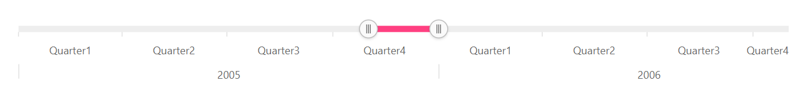
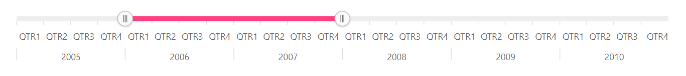
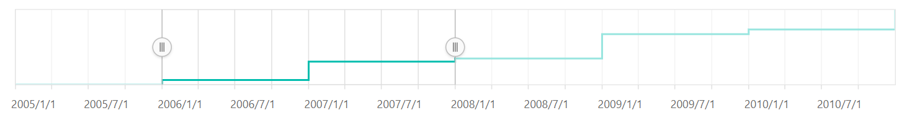
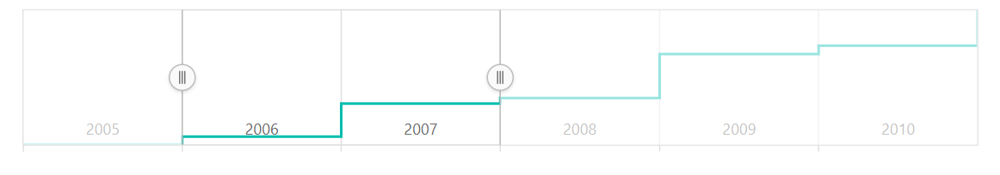
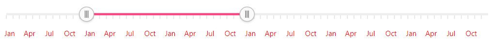

# Labels in ASP.NET Core Range Navigator

## Multilevel labels

The multi-level labels for the Range Selector can be enabled by setting the `enableGrouping` property to **true**. This is restricted to the DateTime axis alone.










## Grouping

The multi-level labels can be grouped using the `groupBy` property with the following interval types:

* Auto
* Years
* Quarter
* Months
* Weeks
* Days
* Hours
* Minutes
* Seconds










## Smart labels

The `labelIntersectAction` property is used to avoid overlapping of labels. The following code sample shows the setting of `labelIntersectAction` property to **Hide**.










## Label positioning

By default, the labels can be placed outside the Range Selector. It can also be placed inside the Range Selector using the `labelPosition` property.










## Labels customization

The font size, color, family, etc. can be customized using the `labelStyle` setting.










## Allow decimals

The [`allowDecimals`](https://help.syncfusion.com/cr/aspnetcore-js2/Syncfusion.EJ2.Charts.RangeNavigator.html#Syncfusion_EJ2_Charts_RangeNavigator_AllowDecimals) property determines whether the range navigator can display decimal values on a numeric scale. The default value is `true`.

* When `true` (default), the range navigator can display decimal intervals and labels when required.
* When `false`, the range navigator displays only whole-number intervals and labels.
* This property applies only when the [`valueType`](https://help.syncfusion.com/cr/aspnetcore-js2/Syncfusion.EJ2.Charts.RangeNavigator.html#Syncfusion_EJ2_Charts_RangeNavigator_ValueType) is set to `Double` (numeric). It has no effect on `DateTime` or `Logarithmic` value types.

Use `allowDecimals="false"` when the selected scale represents whole-number values, such as counts of people, orders, tickets, or products, where labels such as 1.5 are meaningless.

Set the property directly on the Range Navigator component.








