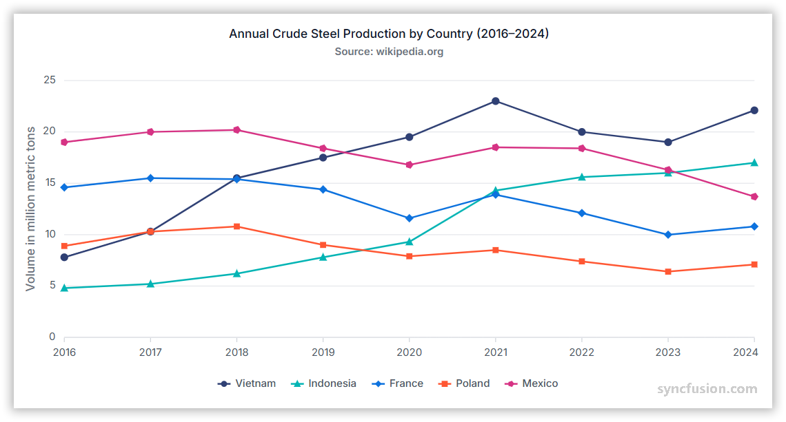

# Series Overview in ASP.NET MVC Chart

## What is a series?

A series represents a set of related data points visualized together on a chart. Each series is plotted using a specific rendering type, such as Line, Column, Area, Spline, or Scatter.

## Single series

A single series refers to a chart that displays only one set of data points. It represents one continuous dataset plotted on the chart, allowing you to visualize trends or values from a single source of data.

## Multiple series

A multiple series chart displays two or more datasets together, allowing you to compare trends or values across different series.

## Binding data with series

You can bind data to the chart using the [`DataSource`](https://help.syncfusion.com/cr/aspnetmvc-js2/Syncfusion.EJ2.Charts.ChartSeries.html#Syncfusion_EJ2_Charts_ChartSeries_DataSource) property within the series configuration. This allows you to connect a JSON dataset or remote data to your chart. To display the data correctly, map the fields from the data to the chart series [`XName`](https://help.syncfusion.com/cr/aspnetmvc-js2/Syncfusion.EJ2.Charts.ChartSeries.html#Syncfusion_EJ2_Charts_ChartSeries_XName) and [`YName`](https://help.syncfusion.com/cr/aspnetmvc-js2/Syncfusion.EJ2.Charts.ChartSeries.html#Syncfusion_EJ2_Charts_ChartSeries_YName) properties.










## Common series properties

| Property | Description |
|---|---|
| [Type](https://help.syncfusion.com/cr/aspnetmvc-js2/Syncfusion.EJ2.Charts.ChartSeries.html#Syncfusion_EJ2_Charts_ChartSeries_Type) | Series rendering type: `Line`, `Column`, `Area`, `Bar`, `Spline`, `Scatter`, etc. |
| [DataSource](https://help.syncfusion.com/cr/aspnetmvc-js2/Syncfusion.EJ2.Charts.ChartSeries.html#Syncfusion_EJ2_Charts_ChartSeries_DataSource) | Array or remote data source bound to the series. |
| [XName](https://help.syncfusion.com/cr/aspnetmvc-js2/Syncfusion.EJ2.Charts.ChartSeries.html#Syncfusion_EJ2_Charts_ChartSeries_XName) | Field name in the data source used for X-axis values. |
| [YName](https://help.syncfusion.com/cr/aspnetmvc-js2/Syncfusion.EJ2.Charts.ChartSeries.html#Syncfusion_EJ2_Charts_ChartSeries_YName) | Field name in the data source used for Y-axis values. |
| [Name](https://help.syncfusion.com/cr/aspnetmvc-js2/Syncfusion.EJ2.Charts.ChartSeries.html#Syncfusion_EJ2_Charts_ChartSeries_Name) | Series label shown in the legend and tooltips. |
| [Visible](https://help.syncfusion.com/cr/aspnetmvc-js2/Syncfusion.EJ2.Charts.ChartSeries.html#Syncfusion_EJ2_Charts_ChartSeries_Visible) | Determines whether the series is displayed on the chart. |
| [Fill](https://help.syncfusion.com/cr/aspnetmvc-js2/Syncfusion.EJ2.Charts.ChartSeries.html#Syncfusion_EJ2_Charts_ChartSeries_Fill) | Fill color or gradient for the series. |
| [Width](https://help.syncfusion.com/cr/aspnetmvc-js2/Syncfusion.EJ2.Charts.ChartSeries.html#Syncfusion_EJ2_Charts_ChartSeries_Width) | Stroke width for line-type series. |
| [Marker](https://help.syncfusion.com/cr/aspnetmvc-js2/Syncfusion.EJ2.Charts.ChartSeries.html#Syncfusion_EJ2_Charts_ChartSeries_Marker) | Object configuring data point markers (visibility, size, shape, fill). |
| [Opacity](https://help.syncfusion.com/cr/aspnetmvc-js2/Syncfusion.EJ2.Charts.ChartSeries.html#Syncfusion_EJ2_Charts_ChartSeries_Opacity) | Series transparency (0.0 - 1.0). |
| [DashArray](https://help.syncfusion.com/cr/aspnetmvc-js2/Syncfusion.EJ2.Charts.ChartSeries.html#Syncfusion_EJ2_Charts_ChartSeries_DashArray) | Dash pattern for stroke lines (for example: `"5,3"`). |
| [Animation](https://help.syncfusion.com/cr/aspnetmvc-js2/Syncfusion.EJ2.Charts.ChartSeries.html#Syncfusion_EJ2_Charts_ChartSeries_Animation) | Animation options (enable, duration, delay) for series rendering. |
| [EnableTooltip](https://help.syncfusion.com/cr/aspnetmvc-js2/Syncfusion.EJ2.Charts.ChartSeries.html#Syncfusion_EJ2_Charts_ChartSeries_EnableTooltip) | Enable or disable tooltip for the series points. |
| [ColumnSpacing](https://help.syncfusion.com/cr/aspnetmvc-js2/Syncfusion.EJ2.Charts.ChartSeries.html#Syncfusion_EJ2_Charts_ChartSeries_ColumnSpacing) | Spacing between bars/columns for Column/Bar series. |
| [ColumnWidth](https://help.syncfusion.com/cr/aspnetmvc-js2/Syncfusion.EJ2.Charts.ChartSeries.html#Syncfusion_EJ2_Charts_ChartSeries_ColumnSpacing) | Width of columns/bars (fractional value 0-1 or pixel value). |
| [Border](https://help.syncfusion.com/cr/aspnetmvc-js2/Syncfusion.EJ2.Charts.ChartSeries.html#Syncfusion_EJ2_Charts_ChartSeries_Border) | Border settings (color, width) for Area, Column, and Bar series. |
| [LegendShape](https://help.syncfusion.com/cr/aspnetmvc-js2/Syncfusion.EJ2.Charts.ChartSeries.html#Syncfusion_EJ2_Charts_ChartSeries_LegendShape) | Shape/icon used in the legend for the series. |
| [EmptyPointSettings](https://help.syncfusion.com/cr/aspnetmvc-js2/Syncfusion.EJ2.Charts.ChartSeries.html#Syncfusion_EJ2_Charts_ChartSeries_EmptyPointSettings) | How to render empty/null points (gap, zero, average, etc.). |
| [ErrorBar](https://help.syncfusion.com/cr/aspnetmvc-js2/Syncfusion.EJ2.Charts.ChartSeries.html#Syncfusion_EJ2_Charts_ChartSeries_ErrorBar) | Configuration to render error bars for each point. |
| [Trendlines](https://help.syncfusion.com/cr/aspnetmvc-js2/Syncfusion.EJ2.Charts.ChartSeries.html#Syncfusion_EJ2_Charts_ChartSeries_Trendlines) | Add trendlines (Linear, Polynomial, Moving Average, etc.). |
| [DataLabel](https://help.syncfusion.com/cr/aspnetmvc-js2/Syncfusion.EJ2.Charts.ChartDataLabelSettings.html) | Configuration object for displaying the value of each data point directly on the chart. |

## Troubleshooting

The following symptoms map to the most common configuration issues.

- **Series does not render**: Confirm that the series [`Type`](https://help.syncfusion.com/cr/aspnetmvc-js2/Syncfusion.EJ2.Charts.ChartSeries.html#Syncfusion_EJ2_Charts_ChartSeries_Type) is valid.
- **Data points are missing**: Verify that the fields referenced by `XName` and `YName` exist on every record and that the bound array is not empty.
- **Legend does not show a label**: Confirm that the `Name` property is set on each `series` element.
- **Series renders on top of another axis unexpectedly**: Verify that the data values fall within the configured `Minimum` and `Maximum` of the bound `PrimaryXAxis` or `PrimaryYAxis`.

## See also

* [Data label](../chart-elements/data-labels)
* [Tooltip](../chart-interactive/tool-tip)
* [Legend](../chart-elements/legend)
* [Axis customization](../axis/axis-customization)
* [Working with data](../data-binding/working-with-data)
