# Blazor 3D Circular Chart Appearance

The appearance of the `Blazor 3D Circular Chart` determines how slices and the surrounding chart area are rendered on the page. You can adjust the visual style using the depth, tilt, and rotation angle of the 3D view, slice explosion, built-in themes, a custom color palette, a background color or image, an outer border, layout margins, and the chart title and subtitle. Together these properties let the chart blend in with any application theme and make the 3D slices distinct and visually appealing.

The appearance of the Blazor 3D Circular Chart is configured through properties on `SfCircularChart3D` and `CircularChart3DSeries`, and through the `CircularChart3DBorder`, `CircularChart3DMargin`, `CircularChart3DTitleStyle`, and `CircularChart3DSubTitleStyle` child components.

N> **Default values:** `Depth` is `30`, `Tilt` is `-45`, `RotationAngle` is `0`, `EnableRotation` is `false`, `Theme` is `Bootstrap5`, `Background` is empty and uses the background resolved from the active theme, `CircularChart3DBorder.Color` is `transparent`, `CircularChart3DBorder.Width` is `0`, the default margins are `10` on each side of `CircularChart3DMargin`, `EnableAnimation` is `true`, and `ExplodeOffset` is `30%`.

## Built-in themes

The 3D Circular Chart ships with built-in themes that control the overall look and feel of the chart, including slice colors, fonts, backgrounds, and supporting elements such as tooltips and legends. Set `Theme` on `SfCircularChart3D` to one of the available Syncfusion themes, such as `Bootstrap5`, `Tailwind`, `Fluent2`, `Material3`, or `HighContrast`, to match the visual style of your application. The default value is `Bootstrap5`.

```cshtml

@using Syncfusion.Blazor
@using Syncfusion.Blazor.Chart3D

<SfCircularChart3D Title="Mobile Browser Statistics" Theme="Theme.Fluent2">
    <CircularChart3DSeriesCollection>
        <CircularChart3DSeries DataSource="@StatisticsDetails" XName="Browser" YName="Users" Name="Browser">
        </CircularChart3DSeries>
    </CircularChart3DSeriesCollection>

    <CircularChart3DLegendSettings Visible="true"></CircularChart3DLegendSettings>
</SfCircularChart3D>

@code {
    public class Statistics
    {
        public string Browser { get; set; }
        public double Users { get; set; }
    }

    public List<Statistics> StatisticsDetails = new List<Statistics>
    {
        new Statistics { Browser = "Chrome", Users = 37 },
        new Statistics { Browser = "UC Browser", Users = 17 },
        new Statistics { Browser = "iPhone", Users = 19 },
        new Statistics { Browser = "Others", Users = 4 },
        new Statistics { Browser = "Opera", Users = 11 },
        new Statistics { Browser = "Android", Users = 12 },
    };
}

```

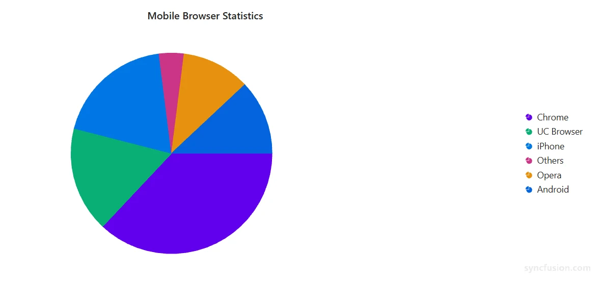

## Custom color palette

The 3D Circular Chart applies colors from the active theme by default. Pass an array of color values to the `Palettes` property to define a custom palette. Colors are applied sequentially to the slices. The `Palettes` property is available in both `SfCircularChart3D` and `CircularChart3DSeries`, and the palette set in the series takes precedence over the palette set in the chart.

### Chart-level palette

Set the `Palettes` property of `SfCircularChart3D` to apply the palette to all the series in the chart.

```cshtml

@using Syncfusion.Blazor.Chart3D

<SfCircularChart3D Title="Mobile Browser Statistics" Palettes="@Palettes">
    <CircularChart3DSeriesCollection>
        <CircularChart3DSeries DataSource="@StatisticsDetails" XName="Browser" YName="Users" Name="Browser">
        </CircularChart3DSeries>
    </CircularChart3DSeriesCollection>

    <CircularChart3DLegendSettings Visible="true"></CircularChart3DLegendSettings>
</SfCircularChart3D>

@code {
    private string[] Palettes = new string[] { "#61EFCD", "#CDDE1F", "#FEC200", "#CA765A", "#2485FA", "#F57D7D" };

    public class Statistics
    {
        public string Browser { get; set; }
        public double Users { get; set; }
    }

    public List<Statistics> StatisticsDetails = new List<Statistics>
    {
        new Statistics { Browser = "Chrome", Users = 37 },
        new Statistics { Browser = "UC Browser", Users = 17 },
        new Statistics { Browser = "iPhone", Users = 19 },
        new Statistics { Browser = "Others", Users = 4 },
        new Statistics { Browser = "Opera", Users = 11 },
        new Statistics { Browser = "Android", Users = 12 },
    };
}

```

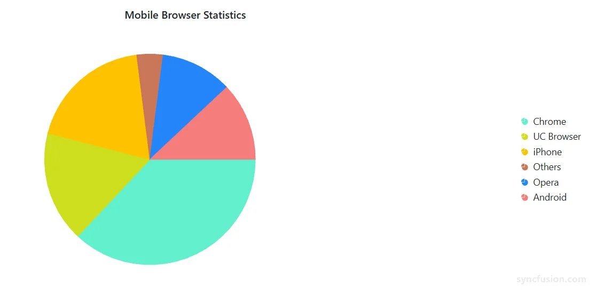

### Series-level palette

Set the `Palettes` property of `CircularChart3DSeries` to apply the palette to a specific series.

```cshtml

@using Syncfusion.Blazor.Chart3D

<SfCircularChart3D Title="Mobile Browser Statistics">
    <CircularChart3DSeriesCollection>
        <CircularChart3DSeries DataSource="@StatisticsDetails" XName="Browser" YName="Users" Name="Browser" Palettes="@Palettes">
        </CircularChart3DSeries>
    </CircularChart3DSeriesCollection>

    <CircularChart3DLegendSettings Visible="true"></CircularChart3DLegendSettings>
</SfCircularChart3D>

@code {
    private string[] Palettes = new string[] { "#498fff", "#ffa060", "#ff68b6", "#81e2a1", "#9c6bff", "#f2c94c" };

    public class Statistics
    {
        public string Browser { get; set; }
        public double Users { get; set; }
    }

    public List<Statistics> StatisticsDetails = new List<Statistics>
    {
        new Statistics { Browser = "Chrome", Users = 37 },
        new Statistics { Browser = "UC Browser", Users = 17 },
        new Statistics { Browser = "iPhone", Users = 19 },
        new Statistics { Browser = "Others", Users = 4 },
        new Statistics { Browser = "Opera", Users = 11 },
        new Statistics { Browser = "Android", Users = 12 },
    };
}

```

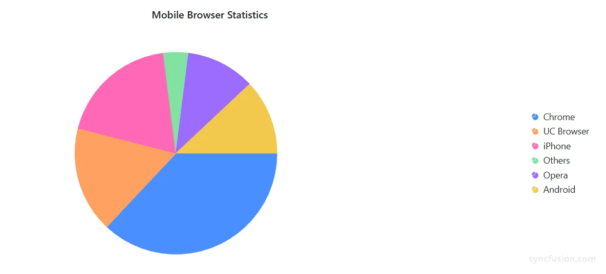

## Background color

Use the `Background` property of `SfCircularChart3D` to set the background color of the chart area. Any valid CSS color value is accepted, including named colors, hexadecimal values, RGB values, and RGBA values. The default value is an empty string, which uses the background resolved from the active theme.

```cshtml

@using Syncfusion.Blazor.Chart3D

<SfCircularChart3D Title="Mobile Browser Statistics" Background="#e6f2ff">
    <CircularChart3DSeriesCollection>
        <CircularChart3DSeries DataSource="@StatisticsDetails" XName="Browser" YName="Users" Name="Browser">
        </CircularChart3DSeries>
    </CircularChart3DSeriesCollection>

    <CircularChart3DLegendSettings Visible="true"></CircularChart3DLegendSettings>
</SfCircularChart3D>

@code {
    public class Statistics
    {
        public string Browser { get; set; }
        public double Users { get; set; }
    }

    public List<Statistics> StatisticsDetails = new List<Statistics>
    {
        new Statistics { Browser = "Chrome", Users = 37 },
        new Statistics { Browser = "UC Browser", Users = 17 },
        new Statistics { Browser = "iPhone", Users = 19 },
        new Statistics { Browser = "Others", Users = 4 },
        new Statistics { Browser = "Opera", Users = 11 },
        new Statistics { Browser = "Android", Users = 12 },
    };
}

```

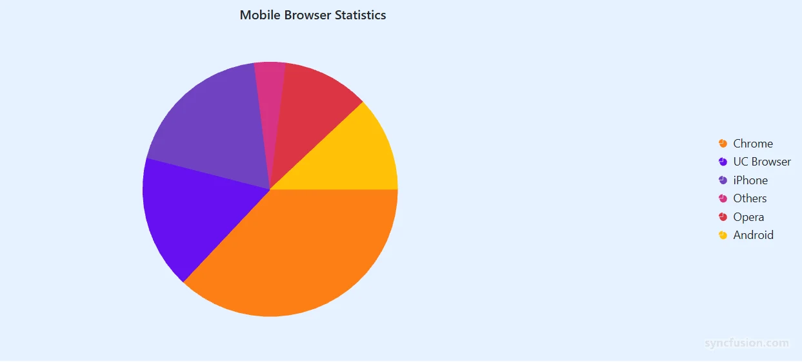

### Background image

Use the `BackgroundImage` property of `SfCircularChart3D` to render an image behind the chart content by providing the image URL.

```cshtml

@using Syncfusion.Blazor.Chart3D

<SfCircularChart3D Title="Mobile Browser Statistics" BackgroundImage="images/background.png">
    <CircularChart3DSeriesCollection>
        <CircularChart3DSeries DataSource="@StatisticsDetails" XName="Browser" YName="Users" Name="Browser">
        </CircularChart3DSeries>
    </CircularChart3DSeriesCollection>

    <CircularChart3DLegendSettings Visible="true"></CircularChart3DLegendSettings>
</SfCircularChart3D>

@code {
    public class Statistics
    {
        public string Browser { get; set; }
        public double Users { get; set; }
    }

    public List<Statistics> StatisticsDetails = new List<Statistics>
    {
        new Statistics { Browser = "Chrome", Users = 37 },
        new Statistics { Browser = "UC Browser", Users = 17 },
        new Statistics { Browser = "iPhone", Users = 19 },
        new Statistics { Browser = "Others", Users = 4 },
        new Statistics { Browser = "Opera", Users = 11 },
        new Statistics { Browser = "Android", Users = 12 },
    };
}

```

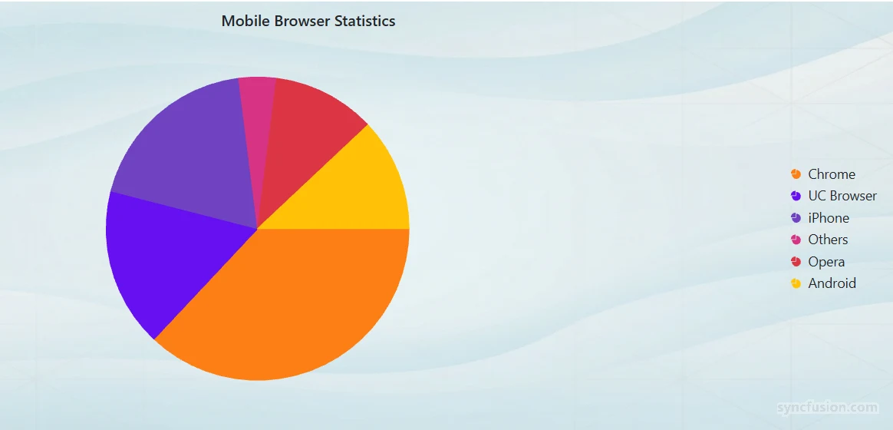

## Chart border

Add a visible border around the chart area using the `CircularChart3DBorder` child component. Set the `Color` and `Width` of the border; the border is rendered only when `Width` is greater than `0`. The default value of `Color` is `transparent` and the default value of `Width` is `0`.

```cshtml

@using Syncfusion.Blazor.Chart3D

<SfCircularChart3D Title="Mobile Browser Statistics">
    <CircularChart3DBorder Color="#498fff" Width="2"></CircularChart3DBorder>
    <CircularChart3DSeriesCollection>
        <CircularChart3DSeries DataSource="@StatisticsDetails" XName="Browser" YName="Users" Name="Browser">
        </CircularChart3DSeries>
    </CircularChart3DSeriesCollection>

    <CircularChart3DLegendSettings Visible="true"></CircularChart3DLegendSettings>
</SfCircularChart3D>

@code {
    public class Statistics
    {
        public string Browser { get; set; }
        public double Users { get; set; }
    }

    public List<Statistics> StatisticsDetails = new List<Statistics>
    {
        new Statistics { Browser = "Chrome", Users = 37 },
        new Statistics { Browser = "UC Browser", Users = 17 },
        new Statistics { Browser = "iPhone", Users = 19 },
        new Statistics { Browser = "Others", Users = 4 },
        new Statistics { Browser = "Opera", Users = 11 },
        new Statistics { Browser = "Android", Users = 12 },
    };
}

```

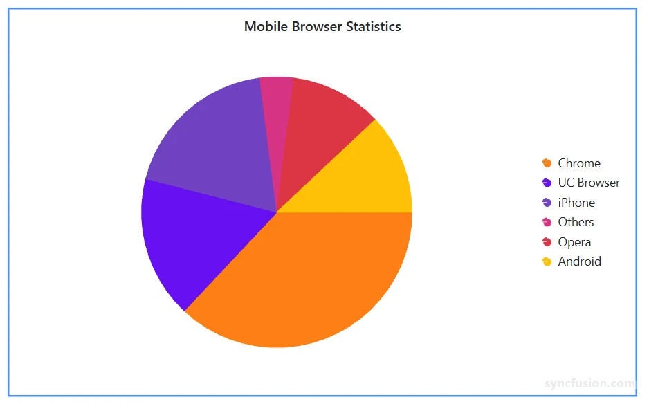

## Chart margin

Use the `CircularChart3DMargin` child component to control the spacing between the 3D Circular Chart content and the edges of its container. Margins are specified independently for the `Left`, `Right`, `Top`, and `Bottom` sides, in pixels. The default value is `10` on each side.

```cshtml

@using Syncfusion.Blazor.Chart3D

<SfCircularChart3D Title="Mobile Browser Statistics">
    <CircularChart3DMargin Left="30" Right="30" Top="20" Bottom="20"></CircularChart3DMargin>
    <CircularChart3DSeriesCollection>
        <CircularChart3DSeries DataSource="@StatisticsDetails" XName="Browser" YName="Users" Name="Browser">
        </CircularChart3DSeries>
    </CircularChart3DSeriesCollection>

    <CircularChart3DLegendSettings Visible="true"></CircularChart3DLegendSettings>
</SfCircularChart3D>

@code {
    public class Statistics
    {
        public string Browser { get; set; }
        public double Users { get; set; }
    }

    public List<Statistics> StatisticsDetails = new List<Statistics>
    {
        new Statistics { Browser = "Chrome", Users = 37 },
        new Statistics { Browser = "UC Browser", Users = 17 },
        new Statistics { Browser = "iPhone", Users = 19 },
        new Statistics { Browser = "Others", Users = 4 },
        new Statistics { Browser = "Opera", Users = 11 },
        new Statistics { Browser = "Android", Users = 12 },
    };
}

```


## Depth, tilt, and rotation angle

The 3D view of the chart is controlled by the `Depth`, `Tilt`, and `RotationAngle` properties of `SfCircularChart3D`. Together these properties define the thickness of the slices and the angle from which the chart is viewed.

* `Depth`: Specifies the thickness of the slices in pixels. The default value is `30`. Setting it to `0` renders a flat equivalent of the chart.
* `Tilt`: Specifies the tilt angle in degrees about the horizontal axis. The default value is `-45`. Negative values expose the top face and the front wall of the slices.
* `RotationAngle`: Specifies the rotation angle in degrees about the central axis. The default value is `0`.

```cshtml

@using Syncfusion.Blazor.Chart3D

<SfCircularChart3D Title="Mobile Browser Statistics" Depth="50" Tilt="-30" RotationAngle="20">
    <CircularChart3DSeriesCollection>
        <CircularChart3DSeries DataSource="@StatisticsDetails" XName="Browser" YName="Users" Name="Browser">
        </CircularChart3DSeries>
    </CircularChart3DSeriesCollection>

    <CircularChart3DLegendSettings Visible="true"></CircularChart3DLegendSettings>
</SfCircularChart3D>

@code {
    public class Statistics
    {
        public string Browser { get; set; }
        public double Users { get; set; }
    }

    public List<Statistics> StatisticsDetails = new List<Statistics>
    {
        new Statistics { Browser = "Chrome", Users = 37 },
        new Statistics { Browser = "UC Browser", Users = 17 },
        new Statistics { Browser = "iPhone", Users = 19 },
        new Statistics { Browser = "Others", Users = 4 },
        new Statistics { Browser = "Opera", Users = 11 },
        new Statistics { Browser = "Android", Users = 12 },
    };
}

```

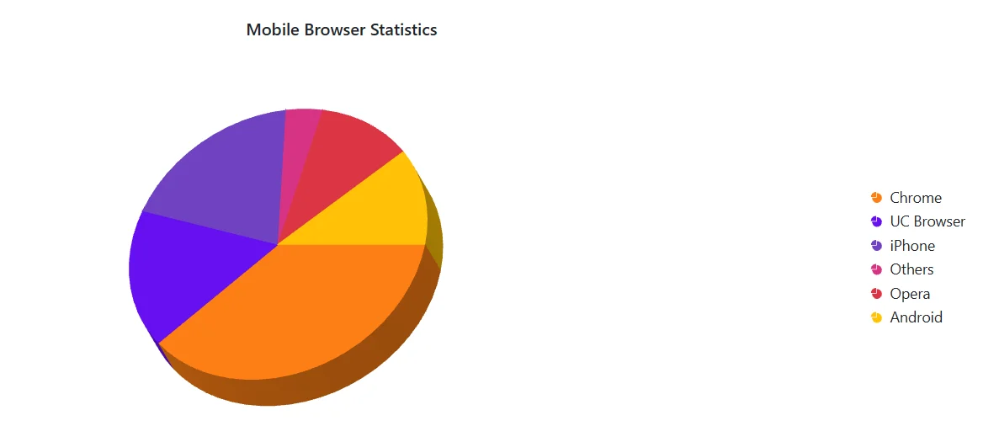

## Interactive 3D rotation

The chart can be rotated and tilted at runtime by using mouse or touch interaction. Set the `EnableRotation` property of `SfCircularChart3D` to `true` to enable this. Dragging horizontally changes the rotation angle, and dragging vertically changes the tilt angle. The default value is `false`.

```cshtml

@using Syncfusion.Blazor.Chart3D

<SfCircularChart3D Title="Mobile Browser Statistics" EnableRotation="true">
    <CircularChart3DSeriesCollection>
        <CircularChart3DSeries DataSource="@StatisticsDetails" XName="Browser" YName="Users" Name="Browser">
        </CircularChart3DSeries>
    </CircularChart3DSeriesCollection>

    <CircularChart3DLegendSettings Visible="true"></CircularChart3DLegendSettings>
</SfCircularChart3D>

@code {
    public class Statistics
    {
        public string Browser { get; set; }
        public double Users { get; set; }
    }

    public List<Statistics> StatisticsDetails = new List<Statistics>
    {
        new Statistics { Browser = "Chrome", Users = 37 },
        new Statistics { Browser = "UC Browser", Users = 17 },
        new Statistics { Browser = "iPhone", Users = 19 },
        new Statistics { Browser = "Others", Users = 4 },
        new Statistics { Browser = "Opera", Users = 11 },
        new Statistics { Browser = "Android", Users = 12 },
    };
}

```

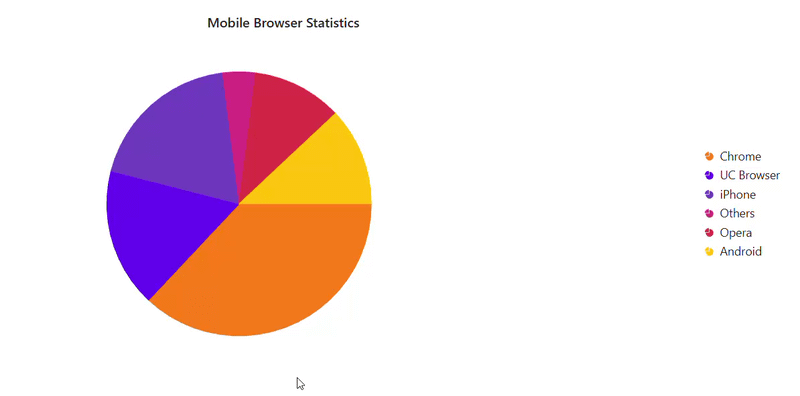

## Slice explosion

Slices can be moved outward from the center to emphasize them. Configure this behavior using the following properties of `CircularChart3DSeries`:

* `Explode`: When `true`, a slice explodes when it is clicked, and clicking it again collapses it. The default value is `false`.
* `ExplodeIndex`: Specifies the zero-based index of the slice to be exploded initially. The default value is `null`.
* `ExplodeAll`: When `true`, all the slices are exploded simultaneously. The default value is `false`.
* `ExplodeOffset`: Specifies the distance, in percentage or pixels, by which the exploded slices are moved. The default value is `30%`.

```cshtml

@using Syncfusion.Blazor.Chart3D

<SfCircularChart3D Title="Mobile Browser Statistics">
    <CircularChart3DSeriesCollection>
        <CircularChart3DSeries DataSource="@StatisticsDetails" XName="Browser" YName="Users" Name="Browser"
                               Explode="true" ExplodeIndex="0" ExplodeOffset="20%">
        </CircularChart3DSeries>
    </CircularChart3DSeriesCollection>

    <CircularChart3DLegendSettings Visible="true"></CircularChart3DLegendSettings>
</SfCircularChart3D>

@code {
    public class Statistics
    {
        public string Browser { get; set; }
        public double Users { get; set; }
    }

    public List<Statistics> StatisticsDetails = new List<Statistics>
    {
        new Statistics { Browser = "Chrome", Users = 37 },
        new Statistics { Browser = "UC Browser", Users = 17 },
        new Statistics { Browser = "iPhone", Users = 19 },
        new Statistics { Browser = "Others", Users = 4 },
        new Statistics { Browser = "Opera", Users = 11 },
        new Statistics { Browser = "Android", Users = 12 },
    };
}

```

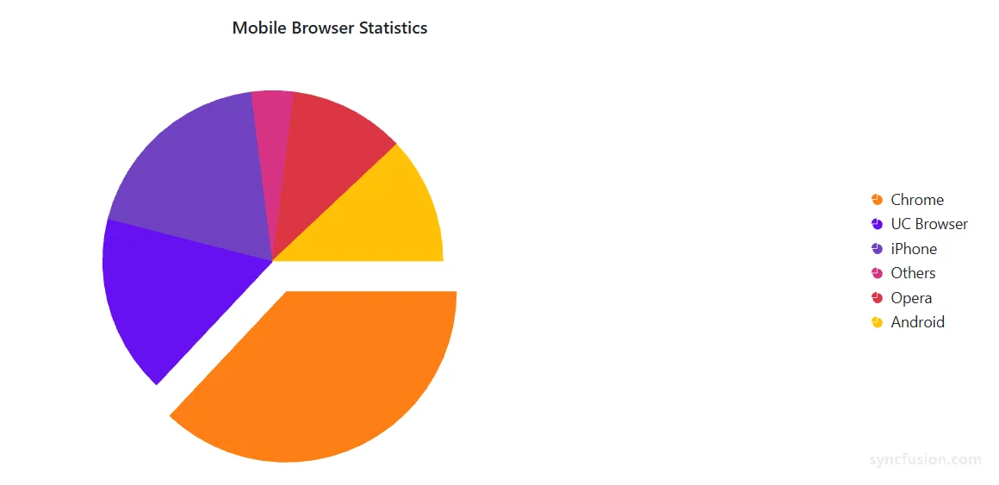

## Animation

Use the `EnableAnimation` property of `SfCircularChart3D` to enable or disable the initial sweep animation that plays when the chart renders for the first time. The default value is `true`. The animation is skipped automatically when the user's system prefers reduced motion.

```cshtml

@using Syncfusion.Blazor.Chart3D

<SfCircularChart3D Title="Mobile Browser Statistics" EnableAnimation="false">
    <CircularChart3DSeriesCollection>
        <CircularChart3DSeries DataSource="@StatisticsDetails" XName="Browser" YName="Users" Name="Browser">
        </CircularChart3DSeries>
    </CircularChart3DSeriesCollection>

    <CircularChart3DLegendSettings Visible="true"></CircularChart3DLegendSettings>
</SfCircularChart3D>

@code {
    public class Statistics
    {
        public string Browser { get; set; }
        public double Users { get; set; }
    }

    public List<Statistics> StatisticsDetails = new List<Statistics>
    {
        new Statistics { Browser = "Chrome", Users = 37 },
        new Statistics { Browser = "UC Browser", Users = 17 },
        new Statistics { Browser = "iPhone", Users = 19 },
        new Statistics { Browser = "Others", Users = 4 },
        new Statistics { Browser = "Opera", Users = 11 },
        new Statistics { Browser = "Android", Users = 12 },
    };
}

```

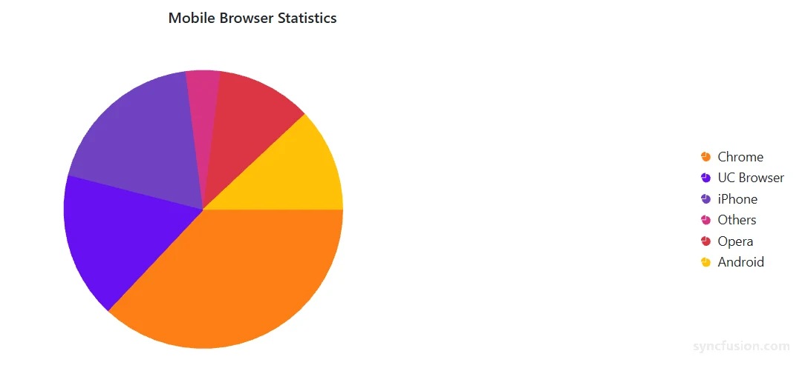

## Title and subtitle

The 3D Circular Chart exposes a chart heading through the `Title` property and an optional secondary line through the `SubTitle` property on `SfCircularChart3D`. These strings default to empty, so the chart renders without a heading unless one is supplied. Use title text to identify the data being shown and subtitle text to add a reporting period, source, or other context.

```cshtml

@using Syncfusion.Blazor.Chart3D

<SfCircularChart3D Title="Mobile Browser Statistics" SubTitle="Market share by users">
    <CircularChart3DSeriesCollection>
        <CircularChart3DSeries DataSource="@StatisticsDetails" XName="Browser" YName="Users" Name="Browser">
        </CircularChart3DSeries>
    </CircularChart3DSeriesCollection>

    <CircularChart3DLegendSettings Visible="true"></CircularChart3DLegendSettings>
</SfCircularChart3D>

@code {
    public class Statistics
    {
        public string Browser { get; set; }
        public double Users { get; set; }
    }

    public List<Statistics> StatisticsDetails = new List<Statistics>
    {
        new Statistics { Browser = "Chrome", Users = 37 },
        new Statistics { Browser = "UC Browser", Users = 17 },
        new Statistics { Browser = "iPhone", Users = 19 },
        new Statistics { Browser = "Others", Users = 4 },
        new Statistics { Browser = "Opera", Users = 11 },
        new Statistics { Browser = "Android", Users = 12 },
    };
}

```

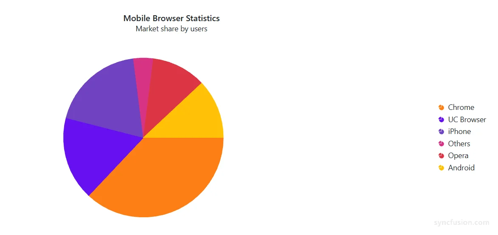

## Customize the title and subtitle

Use `CircularChart3DTitleStyle` and `CircularChart3DSubTitleStyle` to customize how the heading and subheading appear. Both child components expose the same font-level styling properties.

### CircularChart3DTitleStyle properties

Configure the main title appearance:

In the `CircularChart3DTitleStyle`:
* `Size`: Specifies the font size of the title text (for example `"22px"`). When unset, the value falls back to the active Syncfusion theme.
* `Color`: Specifies the font color of the title text. Any valid CSS color value is accepted. When unset, the value falls back to the active theme.
* `FontFamily`: Specifies the font family of the title text. When unset, the value falls back to the active theme.
* `FontWeight`: Specifies the font weight of the title text, for example `Bold`, `400`, or `600`. When unset, the value falls back to the active theme.
* `FontStyle`: Specifies the font style of the title text, for example `normal` or `italic`. The default value is `normal`.
* `Opacity`: Specifies the opacity of the title text. The default value is `1`.

### CircularChart3DSubTitleStyle properties

Configure the subtitle appearance:

In the `CircularChart3DSubTitleStyle`:
* `Size`: Specifies the font size of the subtitle text (for example `"14px"`). When unset, the value falls back to the active Syncfusion theme.
* `Color`: Specifies the font color of the subtitle text. Any valid CSS color value is accepted. When unset, the value falls back to the active theme.
* `FontFamily`: Specifies the font family of the subtitle text. When unset, the value falls back to the active theme.
* `FontWeight`: Specifies the font weight of the subtitle text, for example `Bold`, `400`, or `600`. When unset, the value falls back to the active theme.
* `FontStyle`: Specifies the font style of the subtitle text, for example `normal` or `italic`. The default value is `normal`.
* `Opacity`: Specifies the opacity of the subtitle text. The default value is `1`.

```cshtml

@using Syncfusion.Blazor.Chart3D

<SfCircularChart3D Title="Mobile Browser Statistics" SubTitle="Market share by users">
    <CircularChart3DTitleStyle Size="22px" Color="#2c3e50" FontFamily="Segoe UI" FontWeight="Bold" FontStyle="normal"></CircularChart3DTitleStyle>
    <CircularChart3DSubTitleStyle Size="14px" Color="#7f8c8d" FontFamily="Arial, sans-serif" FontWeight="600" FontStyle="normal"></CircularChart3DSubTitleStyle>
    <CircularChart3DSeriesCollection>
        <CircularChart3DSeries DataSource="@StatisticsDetails" XName="Browser" YName="Users" Name="Browser">
        </CircularChart3DSeries>
    </CircularChart3DSeriesCollection>

    <CircularChart3DLegendSettings Visible="true"></CircularChart3DLegendSettings>
</SfCircularChart3D>

@code {
    public class Statistics
    {
        public string Browser { get; set; }
        public double Users { get; set; }
    }

    public List<Statistics> StatisticsDetails = new List<Statistics>
    {
        new Statistics { Browser = "Chrome", Users = 37 },
        new Statistics { Browser = "UC Browser", Users = 17 },
        new Statistics { Browser = "iPhone", Users = 19 },
        new Statistics { Browser = "Others", Users = 4 },
        new Statistics { Browser = "Opera", Users = 11 },
        new Statistics { Browser = "Android", Users = 12 },
    };
}

```

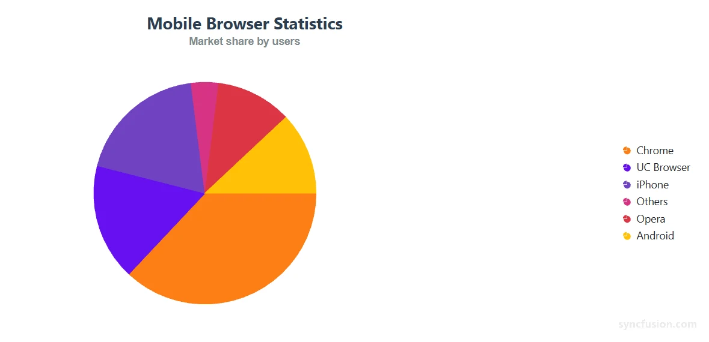

## See also

* [Pie and Doughnut](./pie-and-donut)
* [Empty points](./empty-points)
* [Getting started with Blazor Web App](./getting-started/blazor-web-app)
