# Blazor 3D Circular Chart Data Label

Data labels display information about the data points directly on the slices of the `Blazor 3D Circular Chart`, such as the category name, the value, or the percentage share. You can show the labels inside or outside the slices, format their content, avoid collisions with smart labels, style the connector lines, and customize the label appearance or replace it completely with a template.

Data labels are configured through the `CircularChart3DDataLabelSettings` child component of `CircularChart3DSeries`. The connector, font, and border of the labels are configured through the `CircularChart3DConnector`, `CircularChart3DDataLabelFont`, and `CircularChart3DDataLabelBorder` components inside the data label settings.

N> **Default values:** `Visible` is `false`, `Position` is `CircularChart3DLabelPosition.Inside`, `Fill` is `transparent`, `EnableRotation` is `false`, `Angle` is `0`, and `MaximumLabelWidth` is `0`, which means the label width is not restricted.

## Data labels

Set the `Visible` property of `CircularChart3DDataLabelSettings` to `true` to display a data label for each slice. By default, the label shows the Y value of the point.

```cshtml

@using Syncfusion.Blazor
@using Syncfusion.Blazor.Chart3D

<SfCircularChart3D Title="Mobile Browser Statistics">
    <CircularChart3DLegendSettings Visible="false"></CircularChart3DLegendSettings>
    <CircularChart3DSeriesCollection>
        <CircularChart3DSeries DataSource="@StatisticsDetails" XName="Browser" YName="Users" Name="Browser">
            <CircularChart3DDataLabelSettings Visible="true"></CircularChart3DDataLabelSettings>
        </CircularChart3DSeries>
    </CircularChart3DSeriesCollection>
</SfCircularChart3D>

@code {
    public class Statistics
    {
        public string Browser { get; set; }
        public double Users { get; set; }
    }

    public List<Statistics> StatisticsDetails = new List<Statistics>
    {
        new Statistics { Browser = "Chrome", Users = 37 },
        new Statistics { Browser = "UC Browser", Users = 17 },
        new Statistics { Browser = "iPhone", Users = 19 },
        new Statistics { Browser = "Others", Users = 4 },
        new Statistics { Browser = "Opera", Users = 11 },
        new Statistics { Browser = "Android", Users = 12 },
    };
}

```

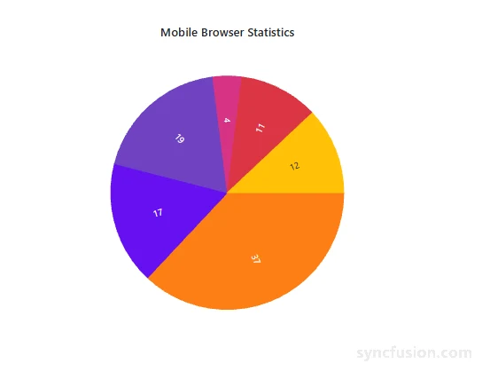

## Label position

The `Position` property of `CircularChart3DDataLabelSettings` places the data labels either `Inside` or `Outside` of the slices by using the `CircularChart3DLabelPosition` enum. The default value is `Inside`.

### Inside

```cshtml

@using Syncfusion.Blazor.Chart3D

<SfCircularChart3D Title="Mobile Browser Statistics">
    <CircularChart3DLegendSettings Visible="false"></CircularChart3DLegendSettings>
    <CircularChart3DSeriesCollection>
        <CircularChart3DSeries DataSource="@StatisticsDetails" XName="Browser" YName="Users" Name="Browser">
            <CircularChart3DDataLabelSettings Visible="true" Position="CircularChart3DLabelPosition.Inside"></CircularChart3DDataLabelSettings>
        </CircularChart3DSeries>
    </CircularChart3DSeriesCollection>
</SfCircularChart3D>

@code {
    public class Statistics
    {
        public string Browser { get; set; }
        public double Users { get; set; }
    }

    public List<Statistics> StatisticsDetails = new List<Statistics>
    {
        new Statistics { Browser = "Chrome", Users = 37 },
        new Statistics { Browser = "UC Browser", Users = 17 },
        new Statistics { Browser = "iPhone", Users = 19 },
        new Statistics { Browser = "Others", Users = 4 },
        new Statistics { Browser = "Opera", Users = 11 },
        new Statistics { Browser = "Android", Users = 12 },
    };
}

```


### Outside

Set `Position` to `Outside` to place the labels around the chart. Outside labels are connected to their slices with connector lines.

```cshtml

@using Syncfusion.Blazor
@using Syncfusion.Blazor.Chart3D

<SfCircularChart3D Title="Mobile Browser Statistics">
    <CircularChart3DLegendSettings Visible="false"></CircularChart3DLegendSettings>
    <CircularChart3DSeriesCollection>
        <CircularChart3DSeries DataSource="@StatisticsDetails" XName="Browser" YName="Users" Name="Browser">
            <CircularChart3DDataLabelSettings Visible="true" Position="CircularChart3DLabelPosition.Outside"></CircularChart3DDataLabelSettings>
        </CircularChart3DSeries>
    </CircularChart3DSeriesCollection>
</SfCircularChart3D>

@code {
    public class Statistics
    {
        public string Browser { get; set; }
        public double Users { get; set; }
    }

    public List<Statistics> StatisticsDetails = new List<Statistics>
    {
        new Statistics { Browser = "Chrome", Users = 37 },
        new Statistics { Browser = "UC Browser", Users = 17 },
        new Statistics { Browser = "iPhone", Users = 19 },
        new Statistics { Browser = "Others", Users = 4 },
        new Statistics { Browser = "Opera", Users = 11 },
        new Statistics { Browser = "Android", Users = 12 },
    };
}

```

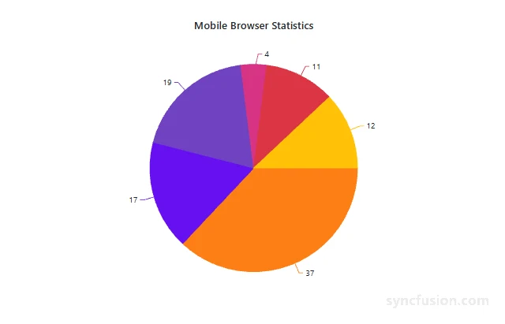

## Label content and formatting

### Custom text mapping

The `Name` property of `CircularChart3DDataLabelSettings` maps a property from the data source that supplies the label text. The mapped text is available as the `${point.text}` token. In the following example, the `Text` property of the data source is displayed as the label.

```cshtml

@using Syncfusion.Blazor
@using Syncfusion.Blazor.Chart3D

<SfCircularChart3D Title="Mobile Browser Statistics">
    <CircularChart3DLegendSettings Visible="false"></CircularChart3DLegendSettings>
    <CircularChart3DSeriesCollection>
        <CircularChart3DSeries DataSource="@StatisticsDetails" XName="Browser" YName="Users" Name="Browser">
            <CircularChart3DDataLabelSettings Visible="true" Name="Text" Position="CircularChart3DLabelPosition.Outside"></CircularChart3DDataLabelSettings>
        </CircularChart3DSeries>
    </CircularChart3DSeriesCollection>
</SfCircularChart3D>

@code {
    public class Statistics
    {
        public string Browser { get; set; }
        public double Users { get; set; }
        public string Text { get; set; }
    }

    public List<Statistics> StatisticsDetails = new List<Statistics>
    {
        new Statistics { Browser = "Chrome", Users = 37, Text = "Chrome: 37%" },
        new Statistics { Browser = "UC Browser", Users = 17, Text = "UC Browser: 17%" },
        new Statistics { Browser = "iPhone", Users = 19, Text = "iPhone: 19%" },
        new Statistics { Browser = "Others", Users = 4, Text = "Others: 4%" },
        new Statistics { Browser = "Opera", Users = 11, Text = "Opera: 11%" },
        new Statistics { Browser = "Android", Users = 12, Text = "Android: 12%" },
    };
}

```

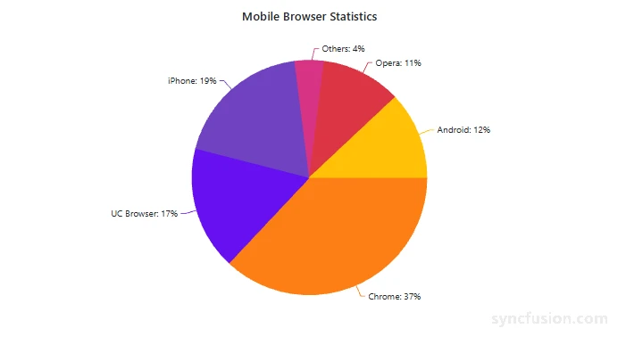

### Label format

The `Format` property customizes the label content by using the following tokens:

| Token | Description |
|-------|-------------|
| `${point.x}` | X value of the point, which is the category name. |
| `${point.y}` | Y value of the point. |
| `${point.percentage}` | Percentage share of the point in the total of the visible slices. |
| `${point.text}` | Text mapped through the `Name` property. |

```cshtml

@using Syncfusion.Blazor.Chart3D

<SfCircularChart3D Title="Mobile Browser Statistics">
    <CircularChart3DLegendSettings Visible="false"></CircularChart3DLegendSettings>
    <CircularChart3DSeriesCollection>
        <CircularChart3DSeries DataSource="@StatisticsDetails" XName="Browser" YName="Users" Name="Browser">
            <CircularChart3DDataLabelSettings Visible="true" Position="CircularChart3DLabelPosition.Outside" Format="${point.x} : ${point.y} (${point.percentage}%)"></CircularChart3DDataLabelSettings>
        </CircularChart3DSeries>
    </CircularChart3DSeriesCollection>
</SfCircularChart3D>

@code {
    public class Statistics
    {
        public string Browser { get; set; }
        public double Users { get; set; }
    }

    public List<Statistics> StatisticsDetails = new List<Statistics>
    {
        new Statistics { Browser = "Chrome", Users = 37 },
        new Statistics { Browser = "UC Browser", Users = 17 },
        new Statistics { Browser = "iPhone", Users = 19 },
        new Statistics { Browser = "Others", Users = 4 },
        new Statistics { Browser = "Opera", Users = 11 },
        new Statistics { Browser = "Android", Users = 12 },
    };
}

```

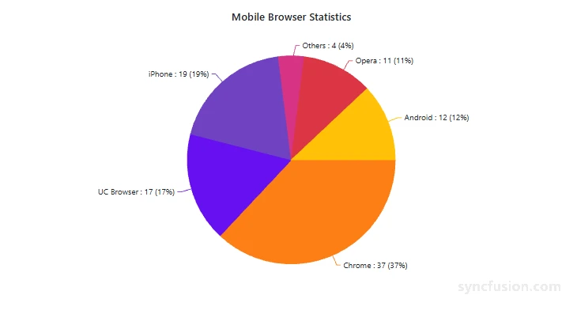

### Maximum label width

When the label text is longer than the available space, use the `MaximumLabelWidth` property to restrict the label width in pixels. Text that exceeds the width is wrapped or trimmed based on the `TextOverflow` property of `CircularChart3DDataLabelFont`.

```cshtml

@using Syncfusion.Blazor.Chart3D

<SfCircularChart3D Title="Mobile Browser Statistics">
    <CircularChart3DLegendSettings Visible="false"></CircularChart3DLegendSettings>
    <CircularChart3DSeriesCollection>
        <CircularChart3DSeries DataSource="@StatisticsDetails" XName="Browser" YName="Users" Name="Browser">
            <CircularChart3DDataLabelSettings Visible="true" Name="Text" Position="CircularChart3DLabelPosition.Outside" MaximumLabelWidth="80"></CircularChart3DDataLabelSettings>
        </CircularChart3DSeries>
    </CircularChart3DSeriesCollection>
</SfCircularChart3D>

@code {
    public class Statistics
    {
        public string Browser { get; set; }
        public double Users { get; set; }
        public string Text { get; set; }
    }

    public List<Statistics> StatisticsDetails = new List<Statistics>
    {
        new Statistics { Browser = "Chrome", Users = 37, Text = "Chrome browser users: 37%" },
        new Statistics { Browser = "UC Browser", Users = 17, Text = "UC Browser users: 17%" },
        new Statistics { Browser = "iPhone", Users = 19, Text = "iPhone Safari users: 19%" },
        new Statistics { Browser = "Others", Users = 4, Text = "Other browsers: 4%" },
        new Statistics { Browser = "Opera", Users = 11, Text = "Opera browser users: 11%" },
        new Statistics { Browser = "Android", Users = 12, Text = "Android browser users: 12%" },
    };
}

```

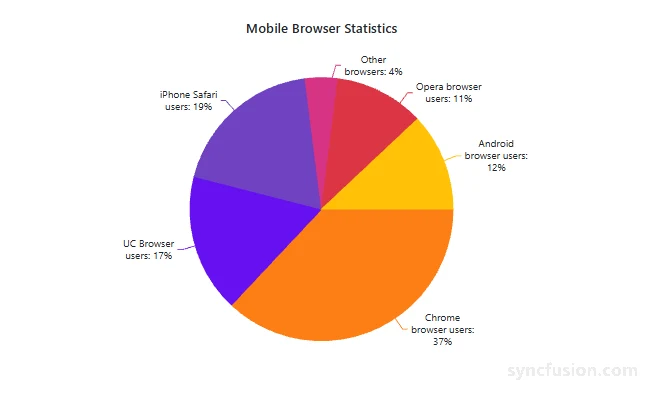

## Smart labels and connectors

### Smart labels

When the slices are small or close to each other, the outside labels can overlap. Set the `EnableSmartLabels` property of `SfCircularChart3D` to `true` to arrange the labels without overlapping with each other, with the slices, or with the legend.

```cshtml

@using Syncfusion.Blazor
@using Syncfusion.Blazor.Chart3D

<SfCircularChart3D Title="Mobile Browser Statistics" EnableSmartLabels="true">
    <CircularChart3DLegendSettings Visible="false"></CircularChart3DLegendSettings>
    <CircularChart3DSeriesCollection>
        <CircularChart3DSeries DataSource="@StatisticsDetails" XName="Browser" YName="Users" Name="Browser">
            <CircularChart3DDataLabelSettings Visible="true" Name="Browser" Position="CircularChart3DLabelPosition.Outside"></CircularChart3DDataLabelSettings>
        </CircularChart3DSeries>
    </CircularChart3DSeriesCollection>
</SfCircularChart3D>

@code {
    public class Statistics
    {
        public string Browser { get; set; }
        public double Users { get; set; }
    }

    public List<Statistics> StatisticsDetails = new List<Statistics>
    {
        new Statistics { Browser = "Chrome", Users = 37 },
        new Statistics { Browser = "UC Browser", Users = 17 },
        new Statistics { Browser = "iPhone", Users = 19 },
        new Statistics { Browser = "Others", Users = 4 },
        new Statistics { Browser = "Opera", Users = 3 },
        new Statistics { Browser = "Android", Users = 3 },
        new Statistics { Browser = "Firefox", Users = 2 },
        new Statistics { Browser = "Edge", Users = 2 },
    };
}

```

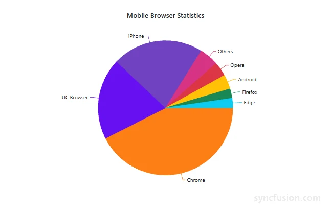

### Connector lines

The `CircularChart3DConnector` component customizes the lines that connect the outside labels to the slices. Use the following properties:

* `Color` - Sets the color of the line. When it is empty, the color of the point is used.
* `Width` - Sets the width of the line in pixels. The default value is `1`.
* `Length` - Sets the length of the line, for example `20px`. When it is not set, a length of 16 pixels is used.
* `DashArray` - Sets the SVG dash pattern of the line, for example `4,2`.

```cshtml

@using Syncfusion.Blazor
@using Syncfusion.Blazor.Chart3D

<SfCircularChart3D Title="Mobile Browser Statistics" EnableSmartLabels="true">
    <CircularChart3DLegendSettings Visible="false"></CircularChart3DLegendSettings>
    <CircularChart3DSeriesCollection>
        <CircularChart3DSeries DataSource="@StatisticsDetails" XName="Browser" YName="Users" Name="Browser">
            <CircularChart3DDataLabelSettings Visible="true" Name="Browser" Position="CircularChart3DLabelPosition.Outside">
                <CircularChart3DConnector Color="#6c757d" Width="2" Length="30px" DashArray="4,2"></CircularChart3DConnector>
            </CircularChart3DDataLabelSettings>
        </CircularChart3DSeries>
    </CircularChart3DSeriesCollection>
</SfCircularChart3D>

@code {
    public class Statistics
    {
        public string Browser { get; set; }
        public double Users { get; set; }
    }

    public List<Statistics> StatisticsDetails = new List<Statistics>
    {
        new Statistics { Browser = "Chrome", Users = 37 },
        new Statistics { Browser = "UC Browser", Users = 17 },
        new Statistics { Browser = "iPhone", Users = 19 },
        new Statistics { Browser = "Others", Users = 4 },
        new Statistics { Browser = "Opera", Users = 11 },
        new Statistics { Browser = "Android", Users = 12 },
    };
}

```

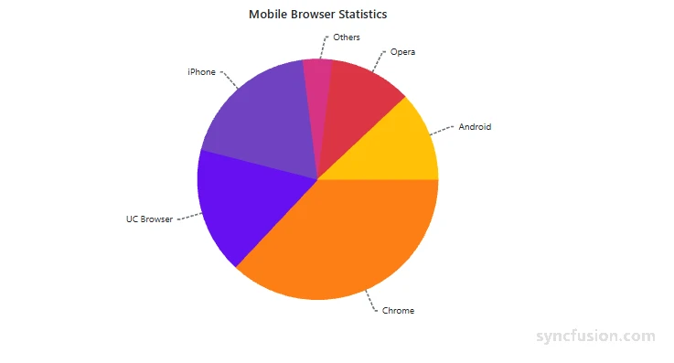

## Label styling, rotation, and templates

### Background and border

The `Fill` property of `CircularChart3DDataLabelSettings` sets the background color of the label. The `CircularChart3DDataLabelBorder` component adds a border to the label through its `Color` and `Width` properties.

```cshtml

@using Syncfusion.Blazor
@using Syncfusion.Blazor.Chart3D

<SfCircularChart3D Title="Mobile Browser Statistics">
    <CircularChart3DLegendSettings Visible="false"></CircularChart3DLegendSettings>
    <CircularChart3DSeriesCollection>
        <CircularChart3DSeries DataSource="@StatisticsDetails" XName="Browser" YName="Users" Name="Browser">
            <CircularChart3DDataLabelSettings Visible="true" Name="Browser" Fill="#f0f4ff" Position="CircularChart3DLabelPosition.Outside">
                <CircularChart3DDataLabelBorder Color="#498fff" Width="2"></CircularChart3DDataLabelBorder>
            </CircularChart3DDataLabelSettings>
        </CircularChart3DSeries>
    </CircularChart3DSeriesCollection>
</SfCircularChart3D>

@code {
    public class Statistics
    {
        public string Browser { get; set; }
        public double Users { get; set; }
    }

    public List<Statistics> StatisticsDetails = new List<Statistics>
    {
        new Statistics { Browser = "Chrome", Users = 37 },
        new Statistics { Browser = "UC Browser", Users = 17 },
        new Statistics { Browser = "iPhone", Users = 19 },
        new Statistics { Browser = "Others", Users = 4 },
        new Statistics { Browser = "Opera", Users = 11 },
        new Statistics { Browser = "Android", Users = 12 },
    };
}

```

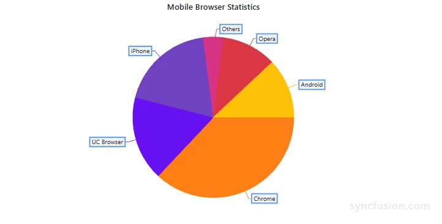

### Font

The `CircularChart3DDataLabelFont` component customizes the label text through the `Size`, `Color`, `FontFamily`, `FontWeight`, `FontStyle`, and `Opacity` properties.

```cshtml

@using Syncfusion.Blazor
@using Syncfusion.Blazor.Chart3D

<SfCircularChart3D Title="Mobile Browser Statistics">
    <CircularChart3DLegendSettings Visible="false"></CircularChart3DLegendSettings>
    <CircularChart3DSeriesCollection>
        <CircularChart3DSeries DataSource="@StatisticsDetails" XName="Browser" YName="Users" Name="Browser">
            <CircularChart3DDataLabelSettings Visible="true" Name="Browser" Position="CircularChart3DLabelPosition.Inside">
                <CircularChart3DDataLabelFont Size="14px" Color="#ffffff" FontWeight="600" FontStyle="italic"></CircularChart3DDataLabelFont>
            </CircularChart3DDataLabelSettings>
        </CircularChart3DSeries>
    </CircularChart3DSeriesCollection>
</SfCircularChart3D>

@code {
    public class Statistics
    {
        public string Browser { get; set; }
        public double Users { get; set; }
    }

    public List<Statistics> StatisticsDetails = new List<Statistics>
    {
        new Statistics { Browser = "Chrome", Users = 37 },
        new Statistics { Browser = "UC Browser", Users = 17 },
        new Statistics { Browser = "iPhone", Users = 19 },
        new Statistics { Browser = "Others", Users = 4 },
        new Statistics { Browser = "Opera", Users = 11 },
        new Statistics { Browser = "Android", Users = 12 },
    };
}

```

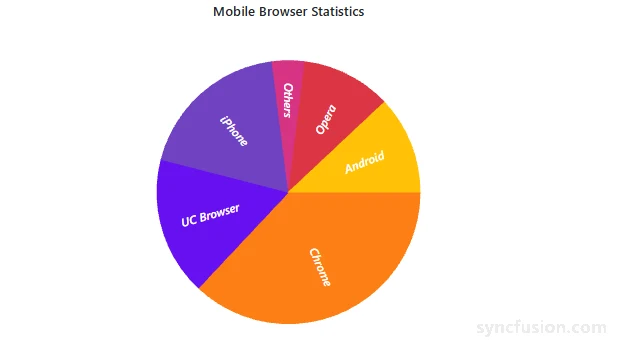

### Label rotation

Set the `EnableRotation` property of `CircularChart3DDataLabelSettings` to `true` to rotate the labels. Use the `Angle` property to specify the rotation angle in degrees.

```cshtml

@using Syncfusion.Blazor
@using Syncfusion.Blazor.Chart3D

<SfCircularChart3D Title="Mobile Browser Statistics">
    <CircularChart3DLegendSettings Visible="false"></CircularChart3DLegendSettings>
    <CircularChart3DSeriesCollection>
        <CircularChart3DSeries DataSource="@StatisticsDetails" XName="Browser" YName="Users" Name="Browser">
            <CircularChart3DDataLabelSettings Visible="true" Name="Browser" EnableRotation="true" Angle="45" Position="CircularChart3DLabelPosition.Inside"></CircularChart3DDataLabelSettings>
        </CircularChart3DSeries>
    </CircularChart3DSeriesCollection>
</SfCircularChart3D>

@code {
    public class Statistics
    {
        public string Browser { get; set; }
        public double Users { get; set; }
    }

    public List<Statistics> StatisticsDetails = new List<Statistics>
    {
        new Statistics { Browser = "Chrome", Users = 37 },
        new Statistics { Browser = "UC Browser", Users = 17 },
        new Statistics { Browser = "iPhone", Users = 19 },
        new Statistics { Browser = "Others", Users = 4 },
        new Statistics { Browser = "Opera", Users = 11 },
        new Statistics { Browser = "Android", Users = 12 },
    };
}

```

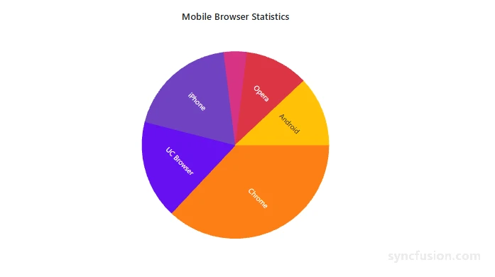

### Label template

The `Template` property of `CircularChart3DDataLabelSettings` replaces the default label with custom HTML content. The template receives the point information as `context`, and you can use the `X`, `Y`, and `Percentage` members of the point to build the content.

```cshtml

@using Syncfusion.Blazor
@using Syncfusion.Blazor.Chart3D

<SfCircularChart3D Title="Mobile Browser Statistics">
    <CircularChart3DLegendSettings Visible="false"></CircularChart3DLegendSettings>
    <CircularChart3DSeriesCollection>
        <CircularChart3DSeries DataSource="@StatisticsDetails" XName="Browser" YName="Users" Name="Browser">
            <CircularChart3DDataLabelSettings Visible="true" Position="CircularChart3DLabelPosition.Outside">
                <Template>
                    <div style="padding: 2px 6px; border-radius: 4px; background-color: #498fff; color: #ffffff;">
                        <span>@context.X: @context.Percentage.ToString("F1")%</span>
                    </div>
                </Template>
            </CircularChart3DDataLabelSettings>
        </CircularChart3DSeries>
    </CircularChart3DSeriesCollection>
</SfCircularChart3D>

@code {
    public class Statistics
    {
        public string Browser { get; set; }
        public double Users { get; set; }
    }

    public List<Statistics> StatisticsDetails = new List<Statistics>
    {
        new Statistics { Browser = "Chrome", Users = 37 },
        new Statistics { Browser = "UC Browser", Users = 17 },
        new Statistics { Browser = "iPhone", Users = 19 },
        new Statistics { Browser = "Others", Users = 4 },
        new Statistics { Browser = "Opera", Users = 11 },
        new Statistics { Browser = "Android", Users = 12 },
    };
}

```

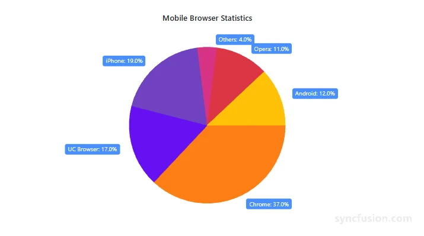

## See also

* [Appearance](./appearance)
* [Pie and doughnut](./pie-and-donut)
* [Empty points](./empty-points)
* [Legend](./legend)
* [Tooltip](./tooltip)
* [Getting started with Blazor Web App](./getting-started/blazor-web-app)
