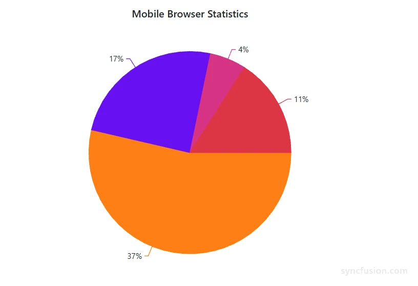
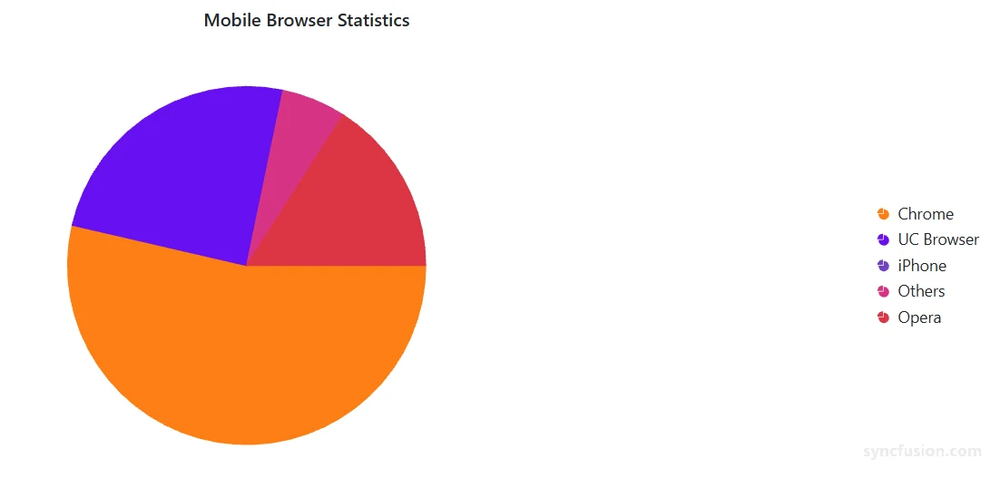
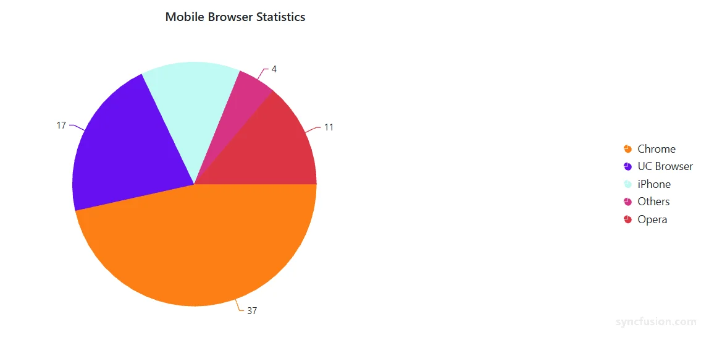

<!-- markdownlint-disable MD040 -->

# Blazor 3D Circular Chart Empty Points

Data points that contain **NaN** or **null** value are considered as empty points. The empty data points can be ignored or not plotted in the chart. Those points can be customized using the `CircularChart3DEmptyPointSettings` in series.

```cshtml

@using Syncfusion.Blazor.Chart3D

<SfCircularChart3D Title="Mobile Browser Statistics">
    <CircularChart3DSeriesCollection>
        <CircularChart3DSeries DataSource="@StatisticsDetails" XName="Browser" YName="Users" Name="Browser">
            <CircularChart3DEmptyPointSettings Mode="@Mode"></CircularChart3DEmptyPointSettings>
            <CircularChart3DDataLabelSettings Visible="true" Name="Text" Position="CircularChart3DLabelPosition.Outside"></CircularChart3DDataLabelSettings>
        </CircularChart3DSeries>
    </CircularChart3DSeriesCollection>
</SfCircularChart3D>

@code {
    public EmptyPointMode Mode = EmptyPointMode.Gap;

    public class Statistics
    {
        public string Browser { get; set; }
        public double? Users { get; set; }
        public string Text { get; set; }
    }

    public List<Statistics> StatisticsDetails = new List<Statistics>
    {
        new Statistics { Browser = "Chrome", Users = 37, Text = "37%" },
        new Statistics { Browser = "UC Browser", Users = 17, Text = "17%" },
        new Statistics { Browser = "iPhone", Users = null, Text = "" },
        new Statistics { Browser = "Others", Users = 4, Text = "4%" },
        new Statistics { Browser = "Opera", Users = 11, Text = "11%" },
    };
}

```



## Empty point mode

The `Mode` property of the `CircularChart3DEmptyPointSettings` can be used to handle the visibility of the empty points. The default mode of the empty point is **Gap**. The supported modes are listed in the following table.

| Mode | Description |
|---|---|
| `Gap` | The empty point slice is hidden. This is the default mode. |
| `Zero` | The empty point is considered as zero. |
| `Drop` | The empty point is removed from the chart and the legend. |
| `Average` | The empty point value is calculated as the average of its neighboring points. |

### Zero

```cshtml

@using Syncfusion.Blazor.Chart3D

<SfCircularChart3D Title="Mobile Browser Statistics">
    <CircularChart3DSeriesCollection>
        <CircularChart3DSeries DataSource="@StatisticsDetails" XName="Browser" YName="Users" Name="Browser">
            <CircularChart3DEmptyPointSettings Mode="EmptyPointMode.Zero"></CircularChart3DEmptyPointSettings>
        </CircularChart3DSeries>
    </CircularChart3DSeriesCollection>

    <CircularChart3DLegendSettings Visible="true"></CircularChart3DLegendSettings>
</SfCircularChart3D>

@code {
    public class Statistics
    {
        public string Browser { get; set; }
        public double? Users { get; set; }
    }

    public List<Statistics> StatisticsDetails = new List<Statistics>
    {
        new Statistics { Browser = "Chrome", Users = 37 },
        new Statistics { Browser = "UC Browser", Users = 17 },
        new Statistics { Browser = "iPhone", Users = double.NaN },
        new Statistics { Browser = "Others", Users = 4 },
        new Statistics { Browser = "Opera", Users = 11 },
    };
}

```



## Empty point fill

The `Fill` property of the `CircularChart3DEmptyPointSettings` can be used to set a specific color for an empty point. By default, the empty point uses the color from the palette.

```cshtml

@using Syncfusion.Blazor.Chart3D

<SfCircularChart3D Title="Mobile Browser Statistics">
    <CircularChart3DSeriesCollection>
        <CircularChart3DSeries DataSource="@StatisticsDetails" XName="Browser" YName="Users" Name="Browser">
            <CircularChart3DEmptyPointSettings Mode="EmptyPointMode.Average" Fill="#c0faf4"></CircularChart3DEmptyPointSettings>
            <CircularChart3DDataLabelSettings Visible="true" Position="CircularChart3DLabelPosition.Outside"></CircularChart3DDataLabelSettings>
        </CircularChart3DSeries>
    </CircularChart3DSeriesCollection>

    <CircularChart3DLegendSettings Visible="true"></CircularChart3DLegendSettings>
</SfCircularChart3D>

@code {
    public class Statistics
    {
        public string Browser { get; set; }
        public double? Users { get; set; }
    }

    public List<Statistics> StatisticsDetails = new List<Statistics>
    {
        new Statistics { Browser = "Chrome", Users = 37 },
        new Statistics { Browser = "UC Browser", Users = 17 },
        new Statistics { Browser = "iPhone", Users = null },
        new Statistics { Browser = "Others", Users = 4 },
        new Statistics { Browser = "Opera", Users = 11 },
    };
}

```



## See also

* [Pie and Doughnut](./pie-and-donut)
* [Appearance](./appearance)
* [Getting started with Blazor Web App](./getting-started/blazor-web-app)
