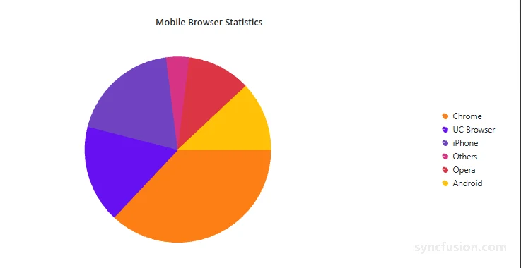
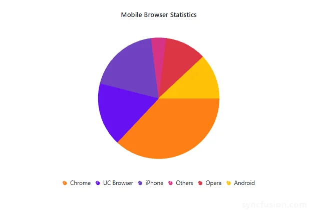
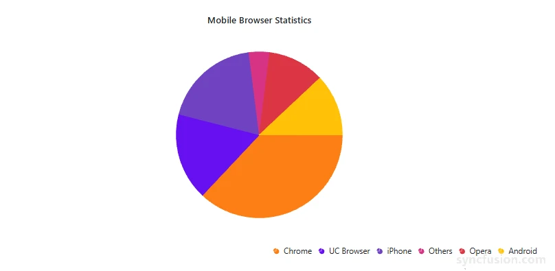
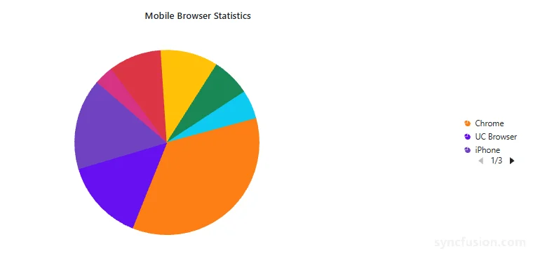
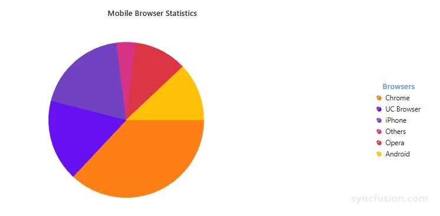
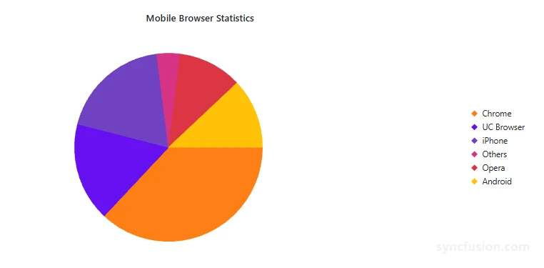
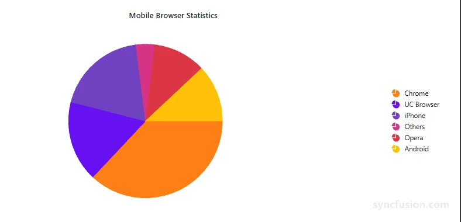
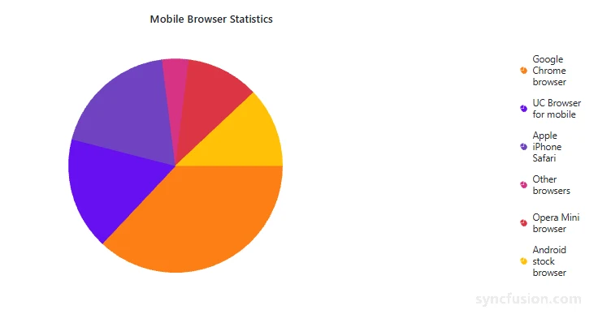
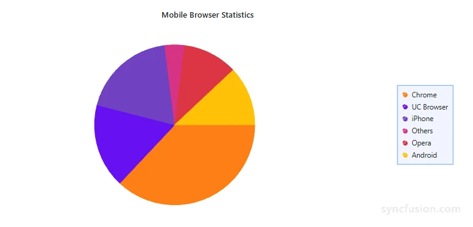
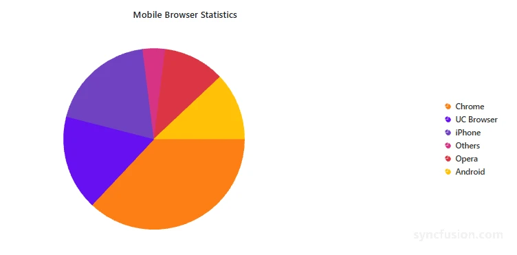

# Blazor 3D Circular Chart Legend

The legend of the `Blazor 3D Circular Chart` lists the slices of the series, each with a shape and the text of its point. It helps you identify the slices and interact with them. You can control its visibility, position, and alignment, enable interactions such as toggling and highlighting slices, and customize its title, shapes, text, and surrounding area.

The legend is configured through the `CircularChart3DLegendSettings` child component of `SfCircularChart3D`.

N> **Default values:** `Visible` is `true`, `Position` is `LegendPosition.Auto`, `Alignment` is `Alignment.Center`, `ToggleVisibility` is `true`, `EnableHighlight` is `false`, `AllowPaging` is `true`, `ShapeWidth` and `ShapeHeight` are `10`, `TitlePosition` is `Chart3DLegendTitlePosition.Top`, `TextWrap` is `TextWrap.Normal`, and `TextOverflow` is `LabelOverflow.Ellipse`.

## Legend visibility and positioning

### Show or hide the legend

Set the `Visible` property of `CircularChart3DLegendSettings` to `true` to display the legend, or to `false` to hide it.

```cshtml

@using Syncfusion.Blazor
@using Syncfusion.Blazor.Chart3D

<SfCircularChart3D Title="Mobile Browser Statistics">
    <CircularChart3DLegendSettings Visible="true"></CircularChart3DLegendSettings>
    <CircularChart3DSeriesCollection>
        <CircularChart3DSeries DataSource="@StatisticsDetails" XName="Browser" YName="Users" Name="Browser">
        </CircularChart3DSeries>
    </CircularChart3DSeriesCollection>
</SfCircularChart3D>

@code {
    public class Statistics
    {
        public string Browser { get; set; }
        public double Users { get; set; }
    }

    public List<Statistics> StatisticsDetails = new List<Statistics>
    {
        new Statistics { Browser = "Chrome", Users = 37 },
        new Statistics { Browser = "UC Browser", Users = 17 },
        new Statistics { Browser = "iPhone", Users = 19 },
        new Statistics { Browser = "Others", Users = 4 },
        new Statistics { Browser = "Opera", Users = 11 },
        new Statistics { Browser = "Android", Users = 12 },
    };
}

```



### Legend position

The `Position` property places the legend by using the `LegendPosition` enum. The available values are:

* `Auto` - Places the legend on the right when the chart width is greater than its height, otherwise at the bottom.
* `Top`, `Bottom`, `Left`, and `Right` - Places the legend at the specified side of the chart.
* `Custom` - Places the legend at the coordinates given by the `CircularChart3DLocation` component.

```cshtml

@using Syncfusion.Blazor
@using Syncfusion.Blazor.Chart3D

<SfCircularChart3D Title="Mobile Browser Statistics">
    <CircularChart3DLegendSettings Visible="true" Position="LegendPosition.Bottom"></CircularChart3DLegendSettings>
    <CircularChart3DSeriesCollection>
        <CircularChart3DSeries DataSource="@StatisticsDetails" XName="Browser" YName="Users" Name="Browser">
        </CircularChart3DSeries>
    </CircularChart3DSeriesCollection>
</SfCircularChart3D>

@code {
    public class Statistics
    {
        public string Browser { get; set; }
        public double Users { get; set; }
    }

    public List<Statistics> StatisticsDetails = new List<Statistics>
    {
        new Statistics { Browser = "Chrome", Users = 37 },
        new Statistics { Browser = "UC Browser", Users = 17 },
        new Statistics { Browser = "iPhone", Users = 19 },
        new Statistics { Browser = "Others", Users = 4 },
        new Statistics { Browser = "Opera", Users = 11 },
        new Statistics { Browser = "Android", Users = 12 },
    };
}

```



### Legend alignment

The `Alignment` property aligns the legend relative to the chart by using the `Alignment` enum. The available values are `Near`, `Center`, and `Far`.

```cshtml

@using Syncfusion.Blazor
@using Syncfusion.Blazor.Chart3D

<SfCircularChart3D Title="Mobile Browser Statistics">
    <CircularChart3DLegendSettings Visible="true" Position="LegendPosition.Bottom" Alignment="Alignment.Far"></CircularChart3DLegendSettings>
    <CircularChart3DSeriesCollection>
        <CircularChart3DSeries DataSource="@StatisticsDetails" XName="Browser" YName="Users" Name="Browser">
        </CircularChart3DSeries>
    </CircularChart3DSeriesCollection>
</SfCircularChart3D>

@code {
    public class Statistics
    {
        public string Browser { get; set; }
        public double Users { get; set; }
    }

    public List<Statistics> StatisticsDetails = new List<Statistics>
    {
        new Statistics { Browser = "Chrome", Users = 37 },
        new Statistics { Browser = "UC Browser", Users = 17 },
        new Statistics { Browser = "iPhone", Users = 19 },
        new Statistics { Browser = "Others", Users = 4 },
        new Statistics { Browser = "Opera", Users = 11 },
        new Statistics { Browser = "Android", Users = 12 },
    };
}

```



## Interactive legend

### Toggle slice visibility

When the `ToggleVisibility` property is `true`, clicking a legend item shows or hides its slice. The remaining visible slices are redistributed to form a complete disc, and their percentages are recalculated. Set the property to `false` to disable this behavior.

```cshtml

@using Syncfusion.Blazor
@using Syncfusion.Blazor.Chart3D

<SfCircularChart3D Title="Mobile Browser Statistics">
    <CircularChart3DLegendSettings Visible="true" ToggleVisibility="true"></CircularChart3DLegendSettings>
    <CircularChart3DSeriesCollection>
        <CircularChart3DSeries DataSource="@StatisticsDetails" XName="Browser" YName="Users" Name="Browser">
            <CircularChart3DDataLabelSettings Visible="true" Format="${point.x} : ${point.percentage}%" Position="CircularChart3DLabelPosition.Outside"></CircularChart3DDataLabelSettings>
        </CircularChart3DSeries>
    </CircularChart3DSeriesCollection>
</SfCircularChart3D>

@code {
    public class Statistics
    {
        public string Browser { get; set; }
        public double Users { get; set; }
    }

    public List<Statistics> StatisticsDetails = new List<Statistics>
    {
        new Statistics { Browser = "Chrome", Users = 37 },
        new Statistics { Browser = "UC Browser", Users = 17 },
        new Statistics { Browser = "iPhone", Users = 19 },
        new Statistics { Browser = "Others", Users = 4 },
        new Statistics { Browser = "Opera", Users = 11 },
        new Statistics { Browser = "Android", Users = 12 },
    };
}

```


### Highlight slices

Set the `EnableHighlight` property to `true` to highlight the corresponding slice when you hover over a legend item.

```cshtml

@using Syncfusion.Blazor
@using Syncfusion.Blazor.Chart3D

<SfCircularChart3D Title="Mobile Browser Statistics">
    <CircularChart3DLegendSettings Visible="true" EnableHighlight="true"></CircularChart3DLegendSettings>
    <CircularChart3DSeriesCollection>
        <CircularChart3DSeries DataSource="@StatisticsDetails" XName="Browser" YName="Users" Name="Browser">
        </CircularChart3DSeries>
    </CircularChart3DSeriesCollection>
</SfCircularChart3D>

@code {
    public class Statistics
    {
        public string Browser { get; set; }
        public double Users { get; set; }
    }

    public List<Statistics> StatisticsDetails = new List<Statistics>
    {
        new Statistics { Browser = "Chrome", Users = 37 },
        new Statistics { Browser = "UC Browser", Users = 17 },
        new Statistics { Browser = "iPhone", Users = 19 },
        new Statistics { Browser = "Others", Users = 4 },
        new Statistics { Browser = "Opera", Users = 11 },
        new Statistics { Browser = "Android", Users = 12 },
    };
}

```


### Legend paging

When the legend items do not fit in the available area, the legend is split into pages with navigation buttons. This behavior is controlled by the `AllowPaging` property, whose default value is `true`. Use the `Width` and `Height` properties to restrict the legend size. Set `AllowPaging` to `false` to disable paging.

```cshtml

@using Syncfusion.Blazor
@using Syncfusion.Blazor.Chart3D

<SfCircularChart3D Title="Mobile Browser Statistics">
    <CircularChart3DLegendSettings Visible="true" Position="LegendPosition.Right" Height="120px" Width="120px" AllowPaging="true"></CircularChart3DLegendSettings>
    <CircularChart3DSeriesCollection>
        <CircularChart3DSeries DataSource="@StatisticsDetails" XName="Browser" YName="Users" Name="Browser">
        </CircularChart3DSeries>
    </CircularChart3DSeriesCollection>
</SfCircularChart3D>

@code {
    public class Statistics
    {
        public string Browser { get; set; }
        public double Users { get; set; }
    }

    public List<Statistics> StatisticsDetails = new List<Statistics>
    {
        new Statistics { Browser = "Chrome", Users = 37 },
        new Statistics { Browser = "UC Browser", Users = 17 },
        new Statistics { Browser = "iPhone", Users = 19 },
        new Statistics { Browser = "Others", Users = 4 },
        new Statistics { Browser = "Opera", Users = 11 },
        new Statistics { Browser = "Android", Users = 12 },
        new Statistics { Browser = "Firefox", Users = 8 },
        new Statistics { Browser = "Edge", Users = 6 },
        new Statistics { Browser = "Safari", Users = 5 },
    };
}

```



## Legend title, shapes, and styling

### Legend title

The `Title` property adds a title to the legend. The `TitlePosition` property places it at the `Top`, `Left`, or `Right` of the legend by using the `Chart3DLegendTitlePosition` enum. The `MaximumTitleWidth` property restricts the title width in pixels, and the `CircularChart3DLegendTitleStyle` component customizes the title font through the `Size`, `Color`, `FontFamily`, `FontWeight`, `FontStyle`, and `Opacity` properties.

```cshtml

@using Syncfusion.Blazor
@using Syncfusion.Blazor.Chart3D

<SfCircularChart3D Title="Mobile Browser Statistics">
    <CircularChart3DLegendSettings Visible="true" Title="Browsers" TitlePosition="Chart3DLegendTitlePosition.Top" MaximumTitleWidth="120">
        <CircularChart3DLegendTitleStyle Size="16px" Color="#498fff" FontWeight="600"></CircularChart3DLegendTitleStyle>
    </CircularChart3DLegendSettings>
    <CircularChart3DSeriesCollection>
        <CircularChart3DSeries DataSource="@StatisticsDetails" XName="Browser" YName="Users" Name="Browser">
        </CircularChart3DSeries>
    </CircularChart3DSeriesCollection>
</SfCircularChart3D>

@code {
    public class Statistics
    {
        public string Browser { get; set; }
        public double Users { get; set; }
    }

    public List<Statistics> StatisticsDetails = new List<Statistics>
    {
        new Statistics { Browser = "Chrome", Users = 37 },
        new Statistics { Browser = "UC Browser", Users = 17 },
        new Statistics { Browser = "iPhone", Users = 19 },
        new Statistics { Browser = "Others", Users = 4 },
        new Statistics { Browser = "Opera", Users = 11 },
        new Statistics { Browser = "Android", Users = 12 },
    };
}

```



### Legend shape

The `LegendShape` property of `CircularChart3DSeries` changes the shape of the legend icons. The available values include `SeriesType`, `Circle`, `Rectangle`, `Triangle`, and `Diamond`. To use your own icon, set the `LegendImageUrl` property of the series to the URL of an image.

```cshtml

@using Syncfusion.Blazor
@using Syncfusion.Blazor.Chart3D

<SfCircularChart3D Title="Mobile Browser Statistics">
    <CircularChart3DLegendSettings Visible="true"></CircularChart3DLegendSettings>
    <CircularChart3DSeriesCollection>
        <CircularChart3DSeries DataSource="@StatisticsDetails" XName="Browser" YName="Users" Name="Browser" LegendShape="LegendShape.Diamond">
        </CircularChart3DSeries>
    </CircularChart3DSeriesCollection>
</SfCircularChart3D>

@code {
    public class Statistics
    {
        public string Browser { get; set; }
        public double Users { get; set; }
    }

    public List<Statistics> StatisticsDetails = new List<Statistics>
    {
        new Statistics { Browser = "Chrome", Users = 37 },
        new Statistics { Browser = "UC Browser", Users = 17 },
        new Statistics { Browser = "iPhone", Users = 19 },
        new Statistics { Browser = "Others", Users = 4 },
        new Statistics { Browser = "Opera", Users = 11 },
        new Statistics { Browser = "Android", Users = 12 },
    };
}

```



### Shape size

The `ShapeWidth` and `ShapeHeight` properties set the size of the legend shape in pixels. The `ShapePadding` property sets the space between the shape and its text.

```cshtml

@using Syncfusion.Blazor
@using Syncfusion.Blazor.Chart3D

<SfCircularChart3D Title="Mobile Browser Statistics">
    <CircularChart3DLegendSettings Visible="true" ShapeWidth="16" ShapeHeight="16" ShapePadding="10"></CircularChart3DLegendSettings>
    <CircularChart3DSeriesCollection>
        <CircularChart3DSeries DataSource="@StatisticsDetails" XName="Browser" YName="Users" Name="Browser">
        </CircularChart3DSeries>
    </CircularChart3DSeriesCollection>
</SfCircularChart3D>

@code {
    public class Statistics
    {
        public string Browser { get; set; }
        public double Users { get; set; }
    }

    public List<Statistics> StatisticsDetails = new List<Statistics>
    {
        new Statistics { Browser = "Chrome", Users = 37 },
        new Statistics { Browser = "UC Browser", Users = 17 },
        new Statistics { Browser = "iPhone", Users = 19 },
        new Statistics { Browser = "Others", Users = 4 },
        new Statistics { Browser = "Opera", Users = 11 },
        new Statistics { Browser = "Android", Users = 12 },
    };
}

```



### Text wrap and overflow

The `TextWrap` property wraps long legend text, and the `TextOverflow` property specifies whether text that still exceeds the available width is shortened with `Clip` or `Ellipse`. Use the `MaximumLabelWidth` property to restrict the width of each legend label in pixels.

```cshtml

@using Syncfusion.Blazor
@using Syncfusion.Blazor.Chart3D

<SfCircularChart3D Title="Mobile Browser Statistics">
    <CircularChart3DLegendSettings Visible="true" Position="LegendPosition.Right" MaximumLabelWidth="80" TextWrap="TextWrap.Wrap" TextOverflow="LabelOverflow.Ellipse"></CircularChart3DLegendSettings>
    <CircularChart3DSeriesCollection>
        <CircularChart3DSeries DataSource="@StatisticsDetails" XName="Browser" YName="Users" Name="Browser">
        </CircularChart3DSeries>
    </CircularChart3DSeriesCollection>
</SfCircularChart3D>

@code {
    public class Statistics
    {
        public string Browser { get; set; }
        public double Users { get; set; }
    }

    public List<Statistics> StatisticsDetails = new List<Statistics>
    {
        new Statistics { Browser = "Google Chrome browser", Users = 37 },
        new Statistics { Browser = "UC Browser for mobile", Users = 17 },
        new Statistics { Browser = "Apple iPhone Safari", Users = 19 },
        new Statistics { Browser = "Other browsers", Users = 4 },
        new Statistics { Browser = "Opera Mini browser", Users = 11 },
        new Statistics { Browser = "Android stock browser", Users = 12 },
    };
}

```



### Background, border, and margin

The `Background` and `Opacity` properties set the fill of the legend area. The `CircularChart3DBorder` component adds a border with the `Color` and `Width` properties, and the `CircularChart3DLegendMargin` component sets the `Left`, `Right`, `Top`, and `Bottom` space around the legend. The `Padding` and `ItemPadding` properties adjust the inner spacing of the legend and the gap between items.

```cshtml

@using Syncfusion.Blazor
@using Syncfusion.Blazor.Chart3D

<SfCircularChart3D Title="Mobile Browser Statistics">
    <CircularChart3DLegendSettings Visible="true" Position="LegendPosition.Right" Background="#f0f4ff" Opacity="0.9" Padding="10" ItemPadding="14">
        <CircularChart3DBorder Color="#498fff" Width="1"></CircularChart3DBorder>
        <CircularChart3DLegendMargin Left="10" Right="10" Top="10" Bottom="10"></CircularChart3DLegendMargin>
    </CircularChart3DLegendSettings>
    <CircularChart3DSeriesCollection>
        <CircularChart3DSeries DataSource="@StatisticsDetails" XName="Browser" YName="Users" Name="Browser">
        </CircularChart3DSeries>
    </CircularChart3DSeriesCollection>
</SfCircularChart3D>

@code {
    public class Statistics
    {
        public string Browser { get; set; }
        public double Users { get; set; }
    }

    public List<Statistics> StatisticsDetails = new List<Statistics>
    {
        new Statistics { Browser = "Chrome", Users = 37 },
        new Statistics { Browser = "UC Browser", Users = 17 },
        new Statistics { Browser = "iPhone", Users = 19 },
        new Statistics { Browser = "Others", Users = 4 },
        new Statistics { Browser = "Opera", Users = 11 },
        new Statistics { Browser = "Android", Users = 12 },
    };
}

```



### Legend text style

The `CircularChart3DLegendTextStyle` component customizes the legend item text through the `Size`, `Color`, `FontFamily`, `FontWeight`, `FontStyle`, and `Opacity` properties.

```cshtml

@using Syncfusion.Blazor
@using Syncfusion.Blazor.Chart3D

<SfCircularChart3D Title="Mobile Browser Statistics">
    <CircularChart3DLegendSettings Visible="true">
        <CircularChart3DLegendTextStyle Size="14px" Color="#333333" FontWeight="600" FontFamily="Segoe UI"></CircularChart3DLegendTextStyle>
    </CircularChart3DLegendSettings>
    <CircularChart3DSeriesCollection>
        <CircularChart3DSeries DataSource="@StatisticsDetails" XName="Browser" YName="Users" Name="Browser">
        </CircularChart3DSeries>
    </CircularChart3DSeriesCollection>
</SfCircularChart3D>

@code {
    public class Statistics
    {
        public string Browser { get; set; }
        public double Users { get; set; }
    }

    public List<Statistics> StatisticsDetails = new List<Statistics>
    {
        new Statistics { Browser = "Chrome", Users = 37 },
        new Statistics { Browser = "UC Browser", Users = 17 },
        new Statistics { Browser = "iPhone", Users = 19 },
        new Statistics { Browser = "Others", Users = 4 },
        new Statistics { Browser = "Opera", Users = 11 },
        new Statistics { Browser = "Android", Users = 12 },
    };
}

```



## See also

* [Appearance](./appearance)
* [Pie and doughnut](./pie-and-donut)
* [Empty points](./empty-points)
* [Data label](./data-label)
* [Tooltip](./tooltip)
* [Getting started with Blazor Web App](./getting-started/blazor-web-app)
