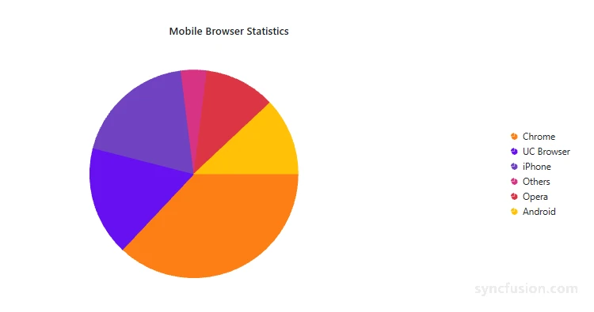
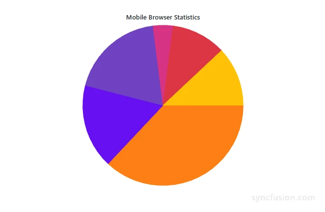
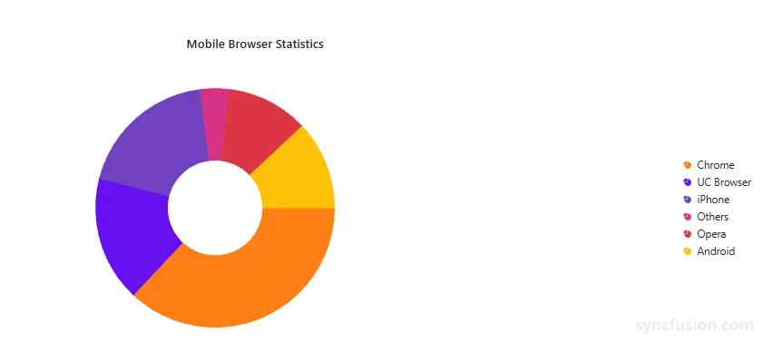
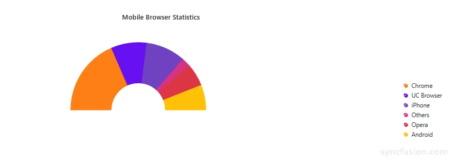
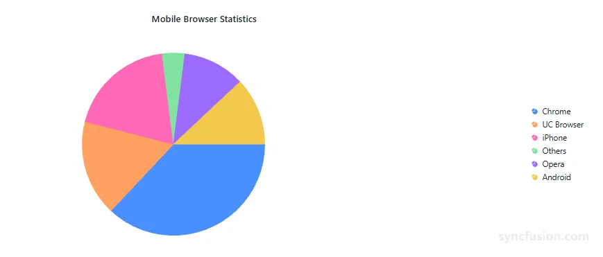

# Pie and Doughnut Chart in Blazor 3D Circular Chart

## 3D Pie Chart

The 3D Pie Chart is used to represent numeric proportional data in divided slices rendered with depth. The [CircularChart3DSeries](https://help.syncfusion.com/cr/blazor/Syncfusion.Blazor.Chart3D.CircularChart3DSeries.html) renders a pie chart by default, since its `InnerRadius` property is `0%`.

```cshtml

@using Syncfusion.Blazor.Chart3D

<SfCircularChart3D Title="Mobile Browser Statistics">
    <CircularChart3DSeriesCollection>
        <CircularChart3DSeries DataSource="@StatisticsDetails" XName="Browser" YName="Users" Name="Browser">
        </CircularChart3DSeries>
    </CircularChart3DSeriesCollection>

    <CircularChart3DLegendSettings Visible="true"></CircularChart3DLegendSettings>
</SfCircularChart3D>

@code {
    public class Statistics
    {
        public string Browser { get; set; }
        public double Users { get; set; }
    }

    public List<Statistics> StatisticsDetails = new List<Statistics>
    {
        new Statistics { Browser = "Chrome", Users = 37 },
        new Statistics { Browser = "UC Browser", Users = 17 },
        new Statistics { Browser = "iPhone", Users = 19 },
        new Statistics { Browser = "Others", Users = 4 },
        new Statistics { Browser = "Opera", Users = 11 },
        new Statistics { Browser = "Android", Users = 12 },
    };
}

```



## Radius customization

The radius of the series is set to `80%` of its size (minimum of chart width and height) by default. The `Radius` property of the series can be used to customize the radius of the chart. The value can be given either in percentage, for example `"80%"`, or in pixels, for example `"180px"`.

```cshtml

@using Syncfusion.Blazor.Chart3D

<SfCircularChart3D Title="Mobile Browser Statistics">
    <CircularChart3DSeriesCollection>
        <CircularChart3DSeries DataSource="@StatisticsDetails" XName="Browser" YName="Users" Name="Browser" Radius="100%">
        </CircularChart3DSeries>
    </CircularChart3DSeriesCollection>

    <CircularChart3DLegendSettings Visible="false"></CircularChart3DLegendSettings>
</SfCircularChart3D>

@code {
    public class Statistics
    {
        public string Browser { get; set; }
        public double Users { get; set; }
    }

    public List<Statistics> StatisticsDetails = new List<Statistics>
    {
        new Statistics { Browser = "Chrome", Users = 37 },
        new Statistics { Browser = "UC Browser", Users = 17 },
        new Statistics { Browser = "iPhone", Users = 19 },
        new Statistics { Browser = "Others", Users = 4 },
        new Statistics { Browser = "Opera", Users = 11 },
        new Statistics { Browser = "Android", Users = 12 },
    };
}

```



## 3D Doughnut Chart

To render a 3D Doughnut Chart, set the `InnerRadius` property of the series to a value greater than `0%`. Use the `Radius` property along with `InnerRadius` to control the thickness of the ring.

```cshtml

@using Syncfusion.Blazor.Chart3D

<SfCircularChart3D Title="Mobile Browser Statistics">
    <CircularChart3DSeriesCollection>
        <CircularChart3DSeries DataSource="@StatisticsDetails" XName="Browser" YName="Users" Name="Browser" Radius="80%" InnerRadius="40%">
        </CircularChart3DSeries>
    </CircularChart3DSeriesCollection>

    <CircularChart3DLegendSettings Visible="true"></CircularChart3DLegendSettings>
</SfCircularChart3D>

@code {
    public class Statistics
    {
        public string Browser { get; set; }
        public double Users { get; set; }
    }

    public List<Statistics> StatisticsDetails = new List<Statistics>
    {
        new Statistics { Browser = "Chrome", Users = 37 },
        new Statistics { Browser = "UC Browser", Users = 17 },
        new Statistics { Browser = "iPhone", Users = 19 },
        new Statistics { Browser = "Others", Users = 4 },
        new Statistics { Browser = "Opera", Users = 11 },
        new Statistics { Browser = "Android", Users = 12 },
    };
}

```



## Start and end angle

By default, the series is rendered as a full circle from `0` to `360` degrees. The `StartAngle` and `EndAngle` properties of the series can be used to render a semi-circular or partial 3D Pie and Doughnut Chart.

```cshtml

@using Syncfusion.Blazor.Chart3D

<SfCircularChart3D Title="Mobile Browser Statistics">
    <CircularChart3DSeriesCollection>
        <CircularChart3DSeries DataSource="@StatisticsDetails" XName="Browser" YName="Users" Name="Browser" InnerRadius="40%" StartAngle="180" EndAngle="360">
        </CircularChart3DSeries>
    </CircularChart3DSeriesCollection>

    <CircularChart3DLegendSettings Visible="true"></CircularChart3DLegendSettings>
</SfCircularChart3D>

@code {
    public class Statistics
    {
        public string Browser { get; set; }
        public double Users { get; set; }
    }

    public List<Statistics> StatisticsDetails = new List<Statistics>
    {
        new Statistics { Browser = "Chrome", Users = 37 },
        new Statistics { Browser = "UC Browser", Users = 17 },
        new Statistics { Browser = "iPhone", Users = 19 },
        new Statistics { Browser = "Others", Users = 4 },
        new Statistics { Browser = "Opera", Users = 11 },
        new Statistics { Browser = "Android", Users = 12 },
    };
}

```



## Point color mapping

The fill color of each slice can be mapped from the data source by using the `PointColorMapping` property of the series. Specify the name of the data source property that holds the color value.

```cshtml

@using Syncfusion.Blazor.Chart3D

<SfCircularChart3D Title="Mobile Browser Statistics">
    <CircularChart3DSeriesCollection>
        <CircularChart3DSeries DataSource="@StatisticsDetails" XName="Browser" YName="Users" Name="Browser" PointColorMapping="Fill">
        </CircularChart3DSeries>
    </CircularChart3DSeriesCollection>

    <CircularChart3DLegendSettings Visible="true"></CircularChart3DLegendSettings>
</SfCircularChart3D>

@code {
    public class Statistics
    {
        public string Browser { get; set; }
        public double Users { get; set; }
        public string Fill { get; set; }
    }

    public List<Statistics> StatisticsDetails = new List<Statistics>
    {
        new Statistics { Browser = "Chrome", Users = 37, Fill = "#498fff" },
        new Statistics { Browser = "UC Browser", Users = 17, Fill = "#ffa060" },
        new Statistics { Browser = "iPhone", Users = 19, Fill = "#ff68b6" },
        new Statistics { Browser = "Others", Users = 4, Fill = "#81e2a1" },
        new Statistics { Browser = "Opera", Users = 11, Fill = "#9c6bff" },
        new Statistics { Browser = "Android", Users = 12, Fill = "#f2c94c" },
    };
}

```



## See also

* [Appearance](./appearance)
* [Empty points](./empty-points)
* [Getting started with Blazor Web App](./getting-started/blazor-web-app)
