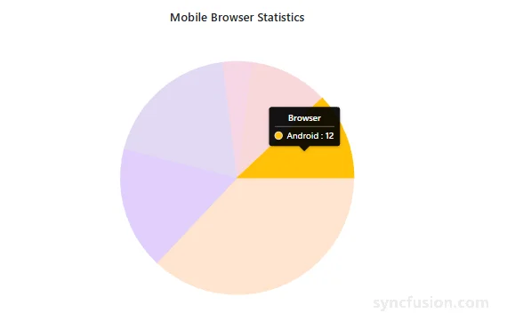
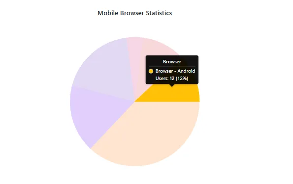
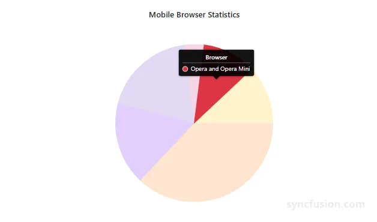
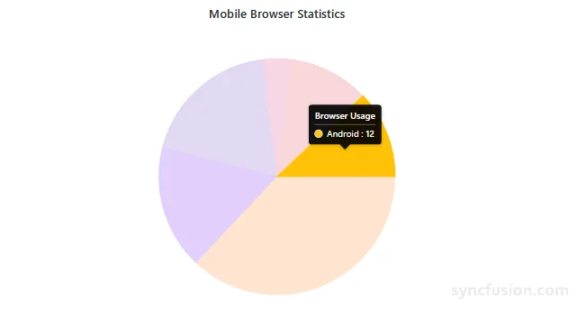
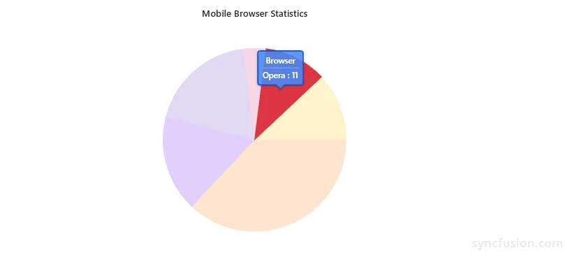
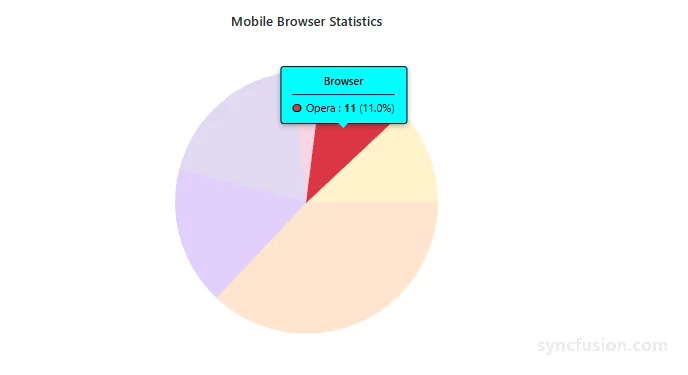

# Blazor 3D Circular Chart Tooltip

The tooltip of the `Blazor 3D Circular Chart` displays information about a slice when you hover over it. You can enable it, format its content and header, map custom text from the data source, customize its appearance and animation, or replace the content with a custom template.

The tooltip is configured through the `CircularChart3DTooltipSettings` child component of `SfCircularChart3D`. Its text style and border are configured through the `CircularChart3DTooltipTextStyle` and `CircularChart3DBorder` components.

N> **Default values:** `Enable` is `false`, `Format` is `${point.x} : <b>${point.y}</b>`, `Opacity` is `0.9`, `EnableAnimation` is `true`, `Duration` is `300`, `FadeOutDuration` is `1000`, `EnableTextWrap` is `false`, and `EnableMarker` is `true`.

## Enabling tooltips

Set the `Enable` property of `CircularChart3DTooltipSettings` to `true` to display the tooltip when you hover over a slice.

```cshtml

@using Syncfusion.Blazor
@using Syncfusion.Blazor.Chart3D

<SfCircularChart3D Title="Mobile Browser Statistics">
    <CircularChart3DSeriesCollection>
        <CircularChart3DSeries DataSource="@StatisticsDetails" XName="Browser" YName="Users" Name="Browser">
        </CircularChart3DSeries>
    </CircularChart3DSeriesCollection>
    <CircularChart3DTooltipSettings Enable="true"></CircularChart3DTooltipSettings>
</SfCircularChart3D>

@code {
    public class Statistics
    {
        public string Browser { get; set; }
        public double Users { get; set; }
    }

    public List<Statistics> StatisticsDetails = new List<Statistics>
    {
        new Statistics { Browser = "Chrome", Users = 37 },
        new Statistics { Browser = "UC Browser", Users = 17 },
        new Statistics { Browser = "iPhone", Users = 19 },
        new Statistics { Browser = "Others", Users = 4 },
        new Statistics { Browser = "Opera", Users = 11 },
        new Statistics { Browser = "Android", Users = 12 },
    };
}

```



To disable the tooltip for a particular series, set the `EnableTooltip` property of `CircularChart3DSeries` to `false`. The default value is `true`.

```cshtml

@using Syncfusion.Blazor
@using Syncfusion.Blazor.Chart3D

<SfCircularChart3D Title="Mobile Browser Statistics">
    <CircularChart3DSeriesCollection>
        <CircularChart3DSeries DataSource="@StatisticsDetails" XName="Browser" YName="Users" Name="Browser" EnableTooltip="false">
        </CircularChart3DSeries>
    </CircularChart3DSeriesCollection>
    <CircularChart3DTooltipSettings Enable="true"></CircularChart3DTooltipSettings>
</SfCircularChart3D>

@code {
    public class Statistics
    {
        public string Browser { get; set; }
        public double Users { get; set; }
    }

    public List<Statistics> StatisticsDetails = new List<Statistics>
    {
        new Statistics { Browser = "Chrome", Users = 37 },
        new Statistics { Browser = "UC Browser", Users = 17 },
        new Statistics { Browser = "iPhone", Users = 19 },
        new Statistics { Browser = "Others", Users = 4 },
        new Statistics { Browser = "Opera", Users = 11 },
        new Statistics { Browser = "Android", Users = 12 },
    };
}

```


## Tooltip formatting and header

### Format

The `Format` property customizes the tooltip content by using the following tokens:

| Token | Description |
|-------|-------------|
| `${point.x}` | X value of the point, which is the category name. |
| `${point.y}` | Y value of the point. |
| `${point.percentage}` | Percentage share of the point in the total of the visible slices. |
| `${point.tooltip}` | Text mapped through the `TooltipMappingName` property of the series. |
| `${series.name}` | Name of the series. |

```cshtml

@using Syncfusion.Blazor
@using Syncfusion.Blazor.Chart3D

<SfCircularChart3D Title="Mobile Browser Statistics">
    <CircularChart3DSeriesCollection>
        <CircularChart3DSeries DataSource="@StatisticsDetails" XName="Browser" YName="Users" Name="Browser">
        </CircularChart3DSeries>
    </CircularChart3DSeriesCollection>
    <CircularChart3DTooltipSettings Enable="true" Format="${series.name} - ${point.x}<br/>Users: <b>${point.y}</b> (${point.percentage}%)"></CircularChart3DTooltipSettings>
</SfCircularChart3D>

@code {
    public class Statistics
    {
        public string Browser { get; set; }
        public double Users { get; set; }
    }

    public List<Statistics> StatisticsDetails = new List<Statistics>
    {
        new Statistics { Browser = "Chrome", Users = 37 },
        new Statistics { Browser = "UC Browser", Users = 17 },
        new Statistics { Browser = "iPhone", Users = 19 },
        new Statistics { Browser = "Others", Users = 4 },
        new Statistics { Browser = "Opera", Users = 11 },
        new Statistics { Browser = "Android", Users = 12 },
    };
}

```



### Tooltip text mapping

The `TooltipMappingName` property of `CircularChart3DSeries` maps a property from the data source that supplies custom tooltip text. Use the `${point.tooltip}` token in the `Format` property to show the mapped text.

```cshtml

@using Syncfusion.Blazor
@using Syncfusion.Blazor.Chart3D

<SfCircularChart3D Title="Mobile Browser Statistics">
    <CircularChart3DSeriesCollection>
        <CircularChart3DSeries DataSource="@StatisticsDetails" XName="Browser" YName="Users" Name="Browser" TooltipMappingName="Description">
        </CircularChart3DSeries>
    </CircularChart3DSeriesCollection>
    <CircularChart3DTooltipSettings Enable="true" Format="${point.tooltip}"></CircularChart3DTooltipSettings>
</SfCircularChart3D>

@code {
    public class Statistics
    {
        public string Browser { get; set; }
        public double Users { get; set; }
        public string Description { get; set; }
    }

    public List<Statistics> StatisticsDetails = new List<Statistics>
    {
        new Statistics { Browser = "Chrome", Users = 37, Description = "Chrome has the largest share" },
        new Statistics { Browser = "UC Browser", Users = 17, Description = "UC Browser is popular on mobile" },
        new Statistics { Browser = "iPhone", Users = 19, Description = "Safari on iPhone" },
        new Statistics { Browser = "Others", Users = 4, Description = "Less common browsers" },
        new Statistics { Browser = "Opera", Users = 11, Description = "Opera and Opera Mini" },
        new Statistics { Browser = "Android", Users = 12, Description = "Android stock browser" },
    };
}

```



### Header

The `Header` property sets the header text of the tooltip. By default, the series name is shown as the header. To hide the header, set the property to a single space.

```cshtml

@using Syncfusion.Blazor
@using Syncfusion.Blazor.Chart3D

<SfCircularChart3D Title="Mobile Browser Statistics">
    <CircularChart3DSeriesCollection>
        <CircularChart3DSeries DataSource="@StatisticsDetails" XName="Browser" YName="Users" Name="Browser">
        </CircularChart3DSeries>
    </CircularChart3DSeriesCollection>
    <CircularChart3DTooltipSettings Enable="true" Header="Browser Usage"></CircularChart3DTooltipSettings>
</SfCircularChart3D>

@code {
    public class Statistics
    {
        public string Browser { get; set; }
        public double Users { get; set; }
    }

    public List<Statistics> StatisticsDetails = new List<Statistics>
    {
        new Statistics { Browser = "Chrome", Users = 37 },
        new Statistics { Browser = "UC Browser", Users = 17 },
        new Statistics { Browser = "iPhone", Users = 19 },
        new Statistics { Browser = "Others", Users = 4 },
        new Statistics { Browser = "Opera", Users = 11 },
        new Statistics { Browser = "Android", Users = 12 },
    };
}

```



## Tooltip customization and templates

### Appearance

Use the following properties of `CircularChart3DTooltipSettings` to customize the appearance of the tooltip:

* `Fill` - Sets the background color of the tooltip. When it is empty, the theme color is used.
* `Opacity` - Sets the opacity of the tooltip background.
* `EnableMarker` - Shows or hides the marker that has the color of the slice.
* `EnableTextWrap` - Wraps long tooltip text into multiple lines.

The `CircularChart3DTooltipTextStyle` component customizes the tooltip text through the `Size`, `Color`, `FontFamily`, `FontWeight`, `FontStyle`, and `Opacity` properties, and the `CircularChart3DBorder` component adds a border through the `Color` and `Width` properties.

```cshtml

@using Syncfusion.Blazor
@using Syncfusion.Blazor.Chart3D

<SfCircularChart3D Title="Mobile Browser Statistics">
    <CircularChart3DSeriesCollection>
        <CircularChart3DSeries DataSource="@StatisticsDetails" XName="Browser" YName="Users" Name="Browser">
        </CircularChart3DSeries>
    </CircularChart3DSeriesCollection>
    <CircularChart3DTooltipSettings Enable="true" Fill="#498fff" Opacity="0.85" EnableMarker="false" EnableTextWrap="true">
        <CircularChart3DTooltipTextStyle Size="14px" Color="#ffffff" FontWeight="600"></CircularChart3DTooltipTextStyle>
        <CircularChart3DBorder Color="#1f4fb3" Width="2"></CircularChart3DBorder>
    </CircularChart3DTooltipSettings>
</SfCircularChart3D>

@code {
    public class Statistics
    {
        public string Browser { get; set; }
        public double Users { get; set; }
    }

    public List<Statistics> StatisticsDetails = new List<Statistics>
    {
        new Statistics { Browser = "Chrome", Users = 37 },
        new Statistics { Browser = "UC Browser", Users = 17 },
        new Statistics { Browser = "iPhone", Users = 19 },
        new Statistics { Browser = "Others", Users = 4 },
        new Statistics { Browser = "Opera", Users = 11 },
        new Statistics { Browser = "Android", Users = 12 },
    };
}

```



### Animation

The tooltip moves smoothly between slices when `EnableAnimation` is `true`. The `Duration` property sets the duration of the movement in milliseconds, and the `FadeOutDuration` property sets the time in milliseconds that the tooltip takes to fade out after the pointer leaves the chart.

```cshtml

@using Syncfusion.Blazor
@using Syncfusion.Blazor.Chart3D

<SfCircularChart3D Title="Mobile Browser Statistics">
    <CircularChart3DSeriesCollection>
        <CircularChart3DSeries DataSource="@StatisticsDetails" XName="Browser" YName="Users" Name="Browser">
        </CircularChart3DSeries>
    </CircularChart3DSeriesCollection>
    <CircularChart3DTooltipSettings Enable="true" EnableAnimation="true" Duration="500" FadeOutDuration="2000"></CircularChart3DTooltipSettings>
</SfCircularChart3D>

@code {
    public class Statistics
    {
        public string Browser { get; set; }
        public double Users { get; set; }
    }

    public List<Statistics> StatisticsDetails = new List<Statistics>
    {
        new Statistics { Browser = "Chrome", Users = 37 },
        new Statistics { Browser = "UC Browser", Users = 17 },
        new Statistics { Browser = "iPhone", Users = 19 },
        new Statistics { Browser = "Others", Users = 4 },
        new Statistics { Browser = "Opera", Users = 11 },
        new Statistics { Browser = "Android", Users = 12 },
    };
}

```


### Tooltip template

The `Template` property of `CircularChart3DTooltipSettings` replaces the default tooltip with custom HTML content. The template receives the point information as `context`, and you can use the `X`, `Y`, and `Percentage` members of the point to build the content.

```cshtml

@using Syncfusion.Blazor
@using Syncfusion.Blazor.Chart3D

<SfCircularChart3D Title="Mobile Browser Statistics">
    <CircularChart3DSeriesCollection>
        <CircularChart3DSeries DataSource="@StatisticsDetails" XName="Browser" YName="Users" Name="Browser">
        </CircularChart3DSeries>
    </CircularChart3DSeriesCollection>
    <CircularChart3DTooltipSettings Enable="true">
        <Template>
            <div style="padding: 6px 10px;">
                <h4 style="margin: 0 0 4px 0;">@context.X</h4>
                <p style="margin: 0;">Users: <strong>@context.Y</strong> (@context.Percentage.ToString("F1")%)</p>
            </div>
        </Template>
    </CircularChart3DTooltipSettings>
</SfCircularChart3D>

@code {
    public class Statistics
    {
        public string Browser { get; set; }
        public double Users { get; set; }
    }

    public List<Statistics> StatisticsDetails = new List<Statistics>
    {
        new Statistics { Browser = "Chrome", Users = 37 },
        new Statistics { Browser = "UC Browser", Users = 17 },
        new Statistics { Browser = "iPhone", Users = 19 },
        new Statistics { Browser = "Others", Users = 4 },
        new Statistics { Browser = "Opera", Users = 11 },
        new Statistics { Browser = "Android", Users = 12 },
    };
}

```



## See also

* [Appearance](./appearance)
* [Pie and doughnut](./pie-and-donut)
* [Empty points](./empty-points)
* [Data label](./data-label)
* [Legend](./legend)
* [Getting started with Blazor Web App](./getting-started/blazor-web-app)
