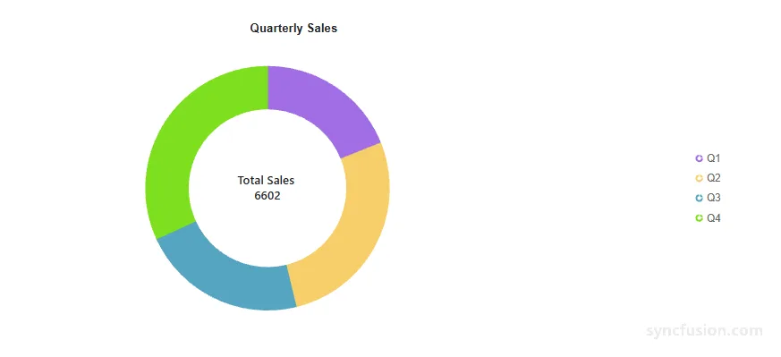

# Blazor Pie and Donut Chart Center Label

The center label feature allows you to place custom text in the middle of pie and donut charts using the [AccumulationChartCenterLabel](https://help.syncfusion.com/cr/blazor/Syncfusion.Blazor.Charts.AccumulationChartCenterLabel.html). This is especially useful for displaying the chart's title, percentage distribution, or other key metrics pertinent to the visualized data.

You can configure the text that appears in the center using the [Text](https://help.syncfusion.com/cr/blazor/Syncfusion.Blazor.Charts.AccumulationChartCenterLabel.html#Syncfusion_Blazor_Charts_AccumulationChartCenterLabel_Text) property within the `AccumulationChartCenterLabel`.

```cshtml
@using Syncfusion.Blazor.Charts

<SfAccumulationChart>
    <AccumulationChartSeriesCollection>
        <AccumulationChartSeries DataSource="@DonutChartPoints" XName="Browser" YName="Users" InnerRadius="60%">
        </AccumulationChartSeries>
    </AccumulationChartSeriesCollection>
    <AccumulationChartCenterLabel Text="Mobile Browser<br>Statistics 2024">
    </AccumulationChartCenterLabel>
    <AccumulationChartLegendSettings Visible="false"></AccumulationChartLegendSettings>
</SfAccumulationChart>

@code {
    public List<DonutData> DonutChartPoints { get; set; } = new List<DonutData>
    {
        new DonutData { Browser = "Chrome", Users = 63.5, DataLabelMappingName = "Chrome: 63.5%"},
        new DonutData { Browser = "Safari", Users = 25.0, DataLabelMappingName = "Safari: 25.0%"},
        new DonutData { Browser = "Samsung Internet", Users = 6.0, DataLabelMappingName = "Samsung Internet: 6.0%"},
        new DonutData { Browser = "UC Browser", Users = 2.5, DataLabelMappingName = "UC Browser: 2.5%"},
        new DonutData { Browser = "Opera", Users = 1.5, DataLabelMappingName = "Opera: 1.5%"},
        new DonutData { Browser = "Others", Users = 1.5, DataLabelMappingName = "Others: 1.5%"}
    };
    public class DonutData
    {
        public string Browser { get; set; }
        public double Users { get; set; }
        public string DataLabelMappingName { get; set; }
    }
}
```


## Hover Text

The center label text can be dynamically updated when hovering over pie or donut chart slices using the [HoverTextFormat](https://help.syncfusion.com/cr/blazor/Syncfusion.Blazor.Charts.AccumulationChartCenterLabel.html#Syncfusion_Blazor_Charts_AccumulationChartCenterLabel_HoverTextFormat) property. This interactive feature enhances user engagement by offering relevant information about specific segments during the exploration of the visualization.

N> Line breaks can be provided to texts in the `HoverTextFormat` property using the `<br>` tag.

```cshtml
@using Syncfusion.Blazor.Charts

<SfAccumulationChart>
    <AccumulationChartSeriesCollection>
        <AccumulationChartSeries DataSource="@DonutChartPoints" XName="Browser" YName="Users" InnerRadius="60%">
        </AccumulationChartSeries>
    </AccumulationChartSeriesCollection>
    <AccumulationChartCenterLabel Text="Mobile Browser<br>Statistics 2024" HoverTextFormat="${point.x} <br> Browser Share <br> ${point.y}%">
    </AccumulationChartCenterLabel>
    <AccumulationChartLegendSettings Visible="false"></AccumulationChartLegendSettings>
</SfAccumulationChart>

@code {
    public List<DonutData> DonutChartPoints { get; set; } = new List<DonutData>
    {
        new DonutData { Browser = "Chrome", Users = 63.5, DataLabelMappingName = "Chrome: 63.5%"},
        new DonutData { Browser = "Safari", Users = 25.0, DataLabelMappingName = "Safari: 25.0%"},
        new DonutData { Browser = "Samsung Internet", Users = 6.0, DataLabelMappingName = "Samsung Internet: 6.0%"},
        new DonutData { Browser = "UC Browser", Users = 2.5, DataLabelMappingName = "UC Browser: 2.5%"},
        new DonutData { Browser = "Opera", Users = 1.5, DataLabelMappingName = "Opera: 1.5%"},
        new DonutData { Browser = "Others", Users = 1.5, DataLabelMappingName = "Others: 1.5%"}
    };
    public class DonutData
    {
        public string Browser { get; set; }
        public double Users { get; set; }
        public string DataLabelMappingName { get; set; }
    }
}
```


## Customization

The appearance of the center label can be customized by using the [AccumulationChartCenterLabelFont](https://help.syncfusion.com/cr/blazor/Syncfusion.Blazor.Charts.AccumulationChartCenterLabelFont.html), which allows you to modify font properties such as size, font-family, font-style, font-weight, and color to enhance the visual presentation of the text displayed in the center of the chart.

The position of the center label can be adjusted using the [XOffset](https://help.syncfusion.com/cr/blazor/Syncfusion.Blazor.Charts.AccumulationChartCenterLabel.html#Syncfusion_Blazor_Charts_AccumulationChartCenterLabel_XOffset) and [YOffset](https://help.syncfusion.com/cr/blazor/Syncfusion.Blazor.Charts.AccumulationChartCenterLabel.html#Syncfusion_Blazor_Charts_AccumulationChartCenterLabel_YOffset) properties in the `AccumulationChartCenterLabel`.

```cshtml
@using Syncfusion.Blazor.Charts

<SfAccumulationChart>
    <AccumulationChartSeriesCollection>
        <AccumulationChartSeries DataSource="@DonutChartPoints" XName="Browser" YName="Users" InnerRadius="60%">
        </AccumulationChartSeries>
    </AccumulationChartSeriesCollection>
    <AccumulationChartCenterLabel Text="Mobile Browser<br>Statistics 2024">
        <AccumulationChartCenterLabelFont Size="15px" FontWeight="600" FontFamily="Roboto" fontStyle="Italic" Color="Blue" ></AccumulationChartCenterLabelFont>
    </AccumulationChartCenterLabel>
    <AccumulationChartLegendSettings Visible="false"></AccumulationChartLegendSettings>
</SfAccumulationChart>

@code {
    public List<DonutData> DonutChartPoints { get; set; } = new List<DonutData>
    {
        new DonutData { Browser = "Chrome", Users = 63.5, DataLabelMappingName = "Chrome: 63.5%"},
        new DonutData { Browser = "Safari", Users = 25.0, DataLabelMappingName = "Safari: 25.0%"},
        new DonutData { Browser = "Samsung Internet", Users = 6.0, DataLabelMappingName = "Samsung Internet: 6.0%"},
        new DonutData { Browser = "UC Browser", Users = 2.5, DataLabelMappingName = "UC Browser: 2.5%"},
        new DonutData { Browser = "Opera", Users = 1.5, DataLabelMappingName = "Opera: 1.5%"},
        new DonutData { Browser = "Others", Users = 1.5, DataLabelMappingName = "Others: 1.5%"}
    };
    public class DonutData
    {
        public string Browser { get; set; }
        public double Users { get; set; }
        public string DataLabelMappingName { get; set; }
    }
}
```


N> Refer to the [Blazor Charts](https://www.syncfusion.com/blazor-components/blazor-charts) feature tour page for its groundbreaking feature representations and also explore the [Blazor Accumulation Chart Example](https://blazor.syncfusion.com/demos/chart/pie?theme=fluent2) to know about the various features of accumulation charts and how it is used to represent numeric proportional data.

## Center label template

The center label supports custom Razor content using the `Template` and `HoverTemplate` properties. The `Template` property displays custom content in the default state, while the `HoverTemplate` property displays custom content when a data point is active.

The template context is of type [AccumulationChartDataPointInfo](https://help.syncfusion.com/cr/blazor/Syncfusion.Blazor.Charts.AccumulationChartDataPointInfo.html). In the default template, the `Y` property contains the total value of the visible data points. In the hover template, the context contains information about the active data point.

```cshtml
@using Syncfusion.Blazor.Charts

<SfAccumulationChart>
    <AccumulationChartSeriesCollection>
        <AccumulationChartSeries DataSource="@ChartData"
                                 XName="Category"
                                 YName="Value"
                                 InnerRadius="60%">
        </AccumulationChartSeries>
    </AccumulationChartSeriesCollection>

    <AccumulationChartCenterLabel>
        <Template>
            @{
                var context = (context as AccumulationChartDataPointInfo);
            }
            <div>
                Total<br />
                @Convert.ToDouble(context?.Y).ToString("C0")
            </div>
        </Template>
        <HoverTemplate>
            @{
                var context = (context as AccumulationChartDataPointInfo);
            }
            <div>
                @context?.X<br />
                @Convert.ToDouble(context?.Y).ToString("C0")
            </div>
        </HoverTemplate>
    </AccumulationChartCenterLabel>
</SfAccumulationChart>

@code {
    public List<ChartDataModel> ChartData { get; set; } = new()
    {
        new ChartDataModel { Category = "Chrome", Value = 63.5 },
        new ChartDataModel { Category = "Safari", Value = 25.0 },
        new ChartDataModel { Category = "Others", Value = 11.5 }
    };

    public class ChartDataModel
    {
        public string Category { get; set; }
        public double Value { get; set; }
    }
}
```


N> The `HoverTemplate` content is temporary and replaces the `Template` content while a data point is active.

### Format center label values

The `Format` property formats the total value displayed in the center label. It supports .NET numeric formats such as `C0` and `N2`, or a pattern containing the `{value}` placeholder.

The `HoverFormat` property applies a .NET numeric format to the active data point's Y value. It formats the `${point.y}` token in [HoverTextFormat](https://help.syncfusion.com/cr/blazor/Syncfusion.Blazor.Charts.AccumulationChartCenterLabel.html#Syncfusion_Blazor_Charts_AccumulationChartCenterLabel_HoverTextFormat) or displays the formatted value directly when `HoverTextFormat` is not specified.

```cshtml
@using Syncfusion.Blazor.Charts

<SfAccumulationChart>
    <AccumulationChartSeriesCollection>
        <AccumulationChartSeries DataSource="@ChartData"
                                 XName="Category"
                                 YName="Value"
                                 InnerRadius="60%">
        </AccumulationChartSeries>
    </AccumulationChartSeriesCollection>

    <AccumulationChartCenterLabel Format="Total<br>{value}"
                                  HoverTextFormat="${point.x}<br>${point.y}"
                                  HoverFormat="C0">
    </AccumulationChartCenterLabel>
</SfAccumulationChart>

@code {
    public List<ChartDataModel> ChartData { get; set; } = new()
    {
        new ChartDataModel { Category = "Chrome", Value = 63.5 },
        new ChartDataModel { Category = "Safari", Value = 25.0 },
        new ChartDataModel { Category = "Others", Value = 11.5 }
    };

    public class ChartDataModel
    {
        public string Category { get; set; }
        public double Value { get; set; }
    }
}
```



N> The `Format` and `HoverFormat` properties apply only to text-based center labels. Values rendered through `Template` or `HoverTemplate` must be formatted within the Razor template.

N> Active-state content requires an interactive Blazor render mode and is not available in static server-side rendering.

## See also

* [Data Label](./data-label)
* [Title and Subtitle](./title-and-sub-title)
* [Annotation](./annotation)
