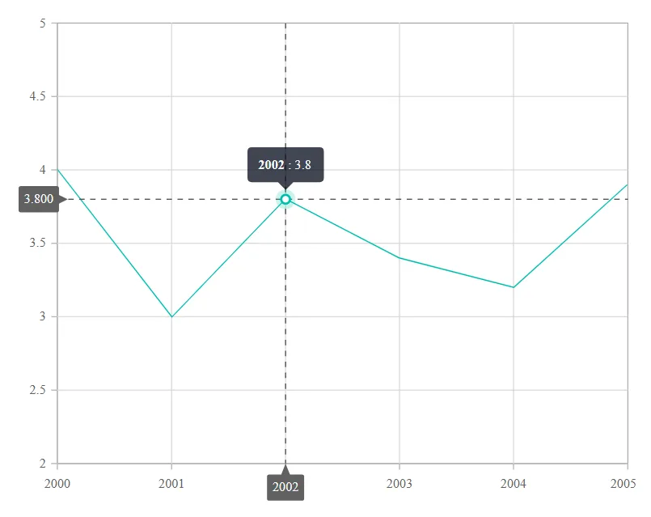
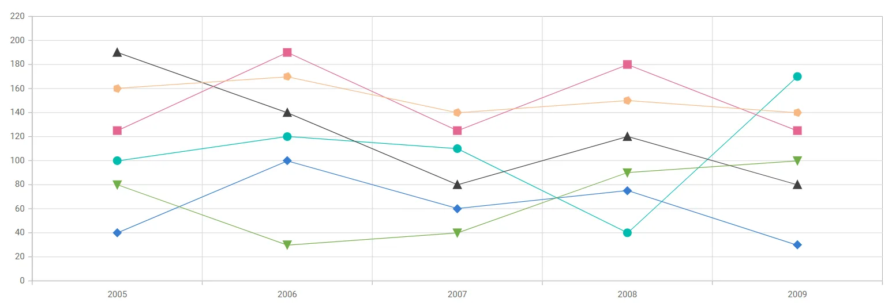
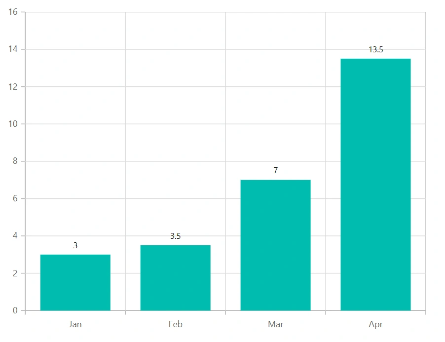
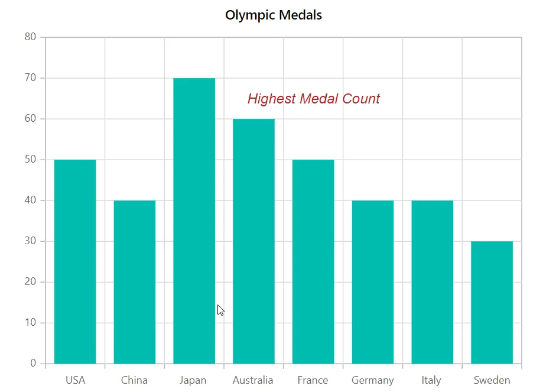

<!-- markdownlint-disable MD036 -->

# Blazor Charts WCAG Accessibility Techniques

<!-- markdownlint-disable MD036 -->

Charts convey information through visual presentation alone, so a chart that relies only on color to separate series becomes unreadable for users with color vision deficiency, for anyone viewing a grayscale printout, and for screen reader users who cannot perceive color at all. The Blazor Chart lets you add redundant cues - line patterns, marker shapes, and text labels - so that every series remains distinguishable without color.

The following techniques help your Blazor Charts meet the [Use of Color](https://www.w3.org/WAI/WCAG22/Understanding/use-of-color.html) success criterion, which requires that color is not the only visual means of conveying information.

## Dash styles for line-based series

A dashed line reads differently from a solid line even when both are drawn in the same color, so varying the [DashArray](https://help.syncfusion.com/cr/blazor/Syncfusion.Blazor.Charts.ChartSeries.html#Syncfusion_Blazor_Charts_ChartSeries_DashArray) value of each line-based series is an effective way to tell them apart. Leave the property unset on one series so that it stays solid, then assign a distinct pattern such as `5,5` and `2,3` to the remaining series.

The same reasoning applies to the crosshair and to constant lines. The [DashArray](https://help.syncfusion.com/cr/blazor/Syncfusion.Blazor.Charts.ChartCrosshairSettings.html#Syncfusion_Blazor_Charts_ChartCrosshairSettings_DashArray) property of [ChartCrosshairSettings](https://help.syncfusion.com/cr/blazor/Syncfusion.Blazor.Charts.ChartCrosshairSettings.html) controls the crosshair pattern, and a [ChartStripline](https://help.syncfusion.com/cr/blazor/Syncfusion.Blazor.Charts.ChartStripline.html) accepts a pattern as well, which distinguishes a threshold line from a data series that crosses it.

```cshtml

@using Syncfusion.Blazor.Charts

<SfChart Title="Monthly Electricity Usage">
    <ChartPrimaryXAxis ValueType="Syncfusion.Blazor.Charts.ValueType.Category"></ChartPrimaryXAxis>

    <ChartPrimaryYAxis>
        <ChartStriplines>
            <ChartStripline Start="80" End="80" Color="red" DashArray="5,5"></ChartStripline>
        </ChartStriplines>
    </ChartPrimaryYAxis>

    <ChartCrosshairSettings Enable="true" DashArray="3,3"></ChartCrosshairSettings>

    <ChartSeriesCollection>
        <ChartSeries DataSource="@UsageReports" XName="Month" YName="Residential" Type="ChartSeriesType.Line"
                     Name="Residential" Width="2">
            <ChartMarker Visible="true" Shape="ChartShape.Circle" Width="8" Height="8"></ChartMarker>
        </ChartSeries>
        <ChartSeries DataSource="@UsageReports" XName="Month" YName="Commercial" Type="ChartSeriesType.Line"
                     Name="Commercial" DashArray="5,5" Width="2">
            <ChartMarker Visible="true" Shape="ChartShape.Diamond" Width="8" Height="8"></ChartMarker>
        </ChartSeries>
    </ChartSeriesCollection>

    <ChartTooltipSettings Enable="true" Format="${series.name} : ${point.y} kWh"></ChartTooltipSettings>
</SfChart>

@code{
    public class ChartData
    {
        public string Month { get; set; }
        public double Residential { get; set; }
        public double Commercial { get; set; }
    }

    public List<ChartData> UsageReports = new List<ChartData>
    {
        new ChartData{ Month= "Jan", Residential= 62, Commercial= 45 },
        new ChartData{ Month= "Feb", Residential= 68, Commercial= 48 },
        new ChartData{ Month= "Mar", Residential= 74, Commercial= 52 },
        new ChartData{ Month= "Apr", Residential= 71, Commercial= 57 },
        new ChartData{ Month= "May", Residential= 84, Commercial= 63 },
        new ChartData{ Month= "Jun", Residential= 91, Commercial= 66 }
    };
}

```



## Marker shape, size, and image

Markers are the most direct non-color cue available in a chart, because a circle, a diamond, and a triangle remain identifiable in a grayscale printout. Set the [Shape](https://help.syncfusion.com/cr/blazor/Syncfusion.Blazor.Charts.ChartCommonMarker.html#Syncfusion_Blazor_Charts_ChartCommonMarker_Shape) property of [ChartMarker](https://help.syncfusion.com/cr/blazor/Syncfusion.Blazor.Charts.ChartCommonMarker.html) to give each series a different shape, and adjust the [Height](https://help.syncfusion.com/cr/blazor/Syncfusion.Blazor.Charts.ChartCommonMarker.html#Syncfusion_Blazor_Charts_ChartCommonMarker_Height) and [Width](https://help.syncfusion.com/cr/blazor/Syncfusion.Blazor.Charts.ChartCommonMarker.html#Syncfusion_Blazor_Charts_ChartCommonMarker_Width) properties when points overlap and need more visual separation.

For area, line, and scatter series, you can also change the marker size, symbol, or image for an individual point rather than for a whole series, either by handling the [OnPointRender](https://help.syncfusion.com/cr/blazor/Syncfusion.Blazor.Charts.ChartEvents.html#Syncfusion_Blazor_Charts_ChartEvents_OnPointRender) event of [ChartEvents](https://help.syncfusion.com/cr/blazor/Syncfusion.Blazor.Charts.ChartEvents.html) or by declaring a [ChartMarker](https://help.syncfusion.com/cr/blazor/Syncfusion.Blazor.Charts.ChartMarker.html) in the series.

```cshtml

@using Syncfusion.Blazor.Charts

<SfChart>
    <ChartPrimaryXAxis ValueType="Syncfusion.Blazor.Charts.ValueType.Category"></ChartPrimaryXAxis>

    <ChartSeriesCollection>
        <ChartSeries DataSource="@TemperatureReports" XName="Day" YName="High" Type="ChartSeriesType.Line" Name="High">
            <ChartMarker Visible="true" Shape="ChartShape.Triangle" Width="12" Height="12"></ChartMarker>
        </ChartSeries>
        <ChartSeries DataSource="@TemperatureReports" XName="Day" YName="Low" Type="ChartSeriesType.Line" Name="Low">
            <ChartMarker Visible="true" Shape="ChartShape.Rectangle" Width="8" Height="8"></ChartMarker>
        </ChartSeries>
    </ChartSeriesCollection>

    <ChartEvents OnPointRender="PointRender"></ChartEvents>
</SfChart>

@code{
    public class ChartData
    {
        public string Day { get; set; }
        public double High { get; set; }
        public double Low { get; set; }
    }

    public List<ChartData> TemperatureReports = new List<ChartData>
    {
        new ChartData{ Day= "Mon", High= 29, Low= 18 },
        new ChartData{ Day= "Tue", High= 32, Low= 20 },
        new ChartData{ Day= "Wed", High= 35, Low= 22 },
        new ChartData{ Day= "Thu", High= 31, Low= 21 },
        new ChartData{ Day= "Fri", High= 28, Low= 17 }
    };

    public void PointRender(PointRenderEventArgs args)
    {
        // Emphasize the peak of each series with a larger marker.
        args.Width = 14;
        args.Height = 14;
        args.Shape = args.Series.Name == "High" ? ChartShape.Triangle : ChartShape.Rectangle;
    }
}

```



## Data labels

A text label is the strongest non-color cue you can add, because it conveys the actual value rather than a visual category. Set the [Visible](https://help.syncfusion.com/cr/blazor/Syncfusion.Blazor.Charts.ChartDataLabel.html#Syncfusion_Blazor_Charts_ChartDataLabel_Visible) property of [ChartDataLabel](https://help.syncfusion.com/cr/blazor/Syncfusion.Blazor.Charts.ChartDataLabel.html) to **true**, and use the [Format](https://help.syncfusion.com/cr/blazor/Syncfusion.Blazor.Charts.ChartDataLabel.html#Syncfusion_Blazor_Charts_ChartDataLabel_Format) property to render the argument and the value together, as in `${point.x}: ${point.y}`. Displaying both is recommended, since a value on its own does not identify which category it belongs to.

```cshtml

@using Syncfusion.Blazor.Charts

<SfChart Title="Defect Count by Stage">
    <ChartPrimaryXAxis ValueType="Syncfusion.Blazor.Charts.ValueType.Category"></ChartPrimaryXAxis>
    <ChartPrimaryYAxis Title="Defects"></ChartPrimaryYAxis>

    <ChartSeriesCollection>
        <ChartSeries DataSource="@DefectReports" XName="Stage" YName="Count" Type="ChartSeriesType.Column">
            <ChartMarker>
                <ChartDataLabel Visible="true" Format="${point.x}: ${point.y}"></ChartDataLabel>
            </ChartMarker>
        </ChartSeries>
    </ChartSeriesCollection>
</SfChart>

@code{
    public class ChartData
    {
        public string Stage { get; set; }
        public double Count { get; set; }
    }

    public List<ChartData> DefectReports = new List<ChartData>
    {
        new ChartData{ Stage= "Design", Count= 18 },
        new ChartData{ Stage= "Development", Count= 42 },
        new ChartData{ Stage= "Testing", Count= 27 },
        new ChartData{ Stage= "Release", Count= 9 }
    };
}

```



In a pie or doughnut chart, displaying the value alone leaves the reader unable to tell how a slice relates to the whole. Placing the label in the [Outside](https://help.syncfusion.com/cr/blazor/Syncfusion.Blazor.Charts.AccumulationLabelPosition.html#Syncfusion_Blazor_Charts_AccumulationLabelPosition_Outside) position draws a connector line back to its slice, which preserves that relationship visually. Customize the connector with [AccumulationChartConnector](https://help.syncfusion.com/cr/blazor/Syncfusion.Blazor.Charts.AccumulationChartConnector.html).

## Annotations

An annotation places explanatory text directly on the chart plane, so a reader does not have to hold a legend or axis label in memory to interpret a point. Use [ChartAnnotation](https://help.syncfusion.com/cr/blazor/Syncfusion.Blazor.Charts.ChartAnnotation.html) to call out an outlier, a threshold crossing, or a notable event, and to state the category or state it represents.

```cshtml

@using Syncfusion.Blazor.Charts

<SfChart Title="Order Volume by Region">
    <ChartPrimaryXAxis ValueType="Syncfusion.Blazor.Charts.ValueType.Category"></ChartPrimaryXAxis>
    <ChartPrimaryYAxis Title="Orders"></ChartPrimaryYAxis>

    <ChartAnnotations>
        <ChartAnnotation X="@("West")" Y="380" CoordinateUnits="Units.Point">
            <ContentTemplate>
                <div style="color: #b33; font-weight: bold;">Record spike in Q4</div>
            </ContentTemplate>
        </ChartAnnotation>
    </ChartAnnotations>

    <ChartSeriesCollection>
        <ChartSeries DataSource="@OrderReports" XName="Region" YName="Orders" Type="ChartSeriesType.Column">
            <ChartMarker>
                <ChartDataLabel Visible="true" Position="Syncfusion.Blazor.Charts.LabelPosition.Outside"></ChartDataLabel>
            </ChartMarker>
        </ChartSeries>
    </ChartSeriesCollection>
</SfChart>

@code{
    public class ChartData
    {
        public string Region { get; set; }
        public double Orders { get; set; }
    }

    public List<ChartData> OrderReports = new List<ChartData>
    {
        new ChartData{ Region= "North", Orders= 210 },
        new ChartData{ Region= "South", Orders= 260 },
        new ChartData{ Region= "East", Orders= 240 },
        new ChartData{ Region= "West", Orders= 385 }
    };
}

```



## Titles and subtitles

Use the [Title](https://help.syncfusion.com/cr/blazor/Syncfusion.Blazor.Charts.SfChart.html#Syncfusion_Blazor_Charts_SfChart_Title) and [SubTitle](https://help.syncfusion.com/cr/blazor/Syncfusion.Blazor.Charts.SfChart.html#Syncfusion_Blazor_Charts_SfChart_SubTitle) properties of [SfChart](https://help.syncfusion.com/cr/blazor/Syncfusion.Blazor.Charts.SfChart.html) to state what the chart shows and the time frame or conditions it covers. A title such as "Average Response Time by Support Tier, Q3 2025" tells a reader what the chart is about before they examine any individual point, which no color choice can achieve.

```cshtml

@using Syncfusion.Blazor.Charts

<SfChart Title="Average Response Time by Support Tier"
         SubTitle="First reply, Q3 2025">
    <ChartPrimaryXAxis ValueType="Syncfusion.Blazor.Charts.ValueType.Category" Title="Support tier"></ChartPrimaryXAxis>
    <ChartPrimaryYAxis Title="Minutes"></ChartPrimaryYAxis>

    <ChartSeriesCollection>
        <ChartSeries DataSource="@ResponseReports" XName="Tier" YName="Minutes" Type="ChartSeriesType.Bar">
            <ChartMarker>
                <ChartDataLabel Visible="true"></ChartDataLabel>
            </ChartMarker>
        </ChartSeries>
    </ChartSeriesCollection>
</SfChart>

@code{
    public class ChartData
    {
        public string Tier { get; set; }
        public double Minutes { get; set; }
    }

    public List<ChartData> ResponseReports = new List<ChartData>
    {
        new ChartData{ Tier= "Basic", Minutes= 42 },
        new ChartData{ Tier= "Standard", Minutes= 27 },
        new ChartData{ Tier= "Premium", Minutes= 11 }
    };
}

```

## Legend

Add a [ChartLegendSettings](https://help.syncfusion.com/cr/blazor/Syncfusion.Blazor.Charts.ChartLegendSettings.html) so that each series has a visible name that pairs with its dash style or marker shape. A legend item combines the series name with the series color and marker, which lets a reader confirm that the solid line with circular markers is the series named in the legend. Hiding the legend removes that pairing, so keep it visible whenever line styles or marker shapes carry meaning.

```cshtml

@using Syncfusion.Blazor.Charts

<SfChart Title="Temperature Range">
    <ChartPrimaryXAxis ValueType="Syncfusion.Blazor.Charts.ValueType.Category"></ChartPrimaryXAxis>

    <ChartLegendSettings Visible="true" Position="LegendPosition.Top"></ChartLegendSettings>

    <ChartSeriesCollection>
        <ChartSeries DataSource="@RangeReports" XName="Day" YName="Min" Type="ChartSeriesType.Line" Name="Minimum" DashArray="5,5">
            <ChartMarker Visible="true" Shape="ChartShape.Rectangle" Width="8" Height="8"></ChartMarker>
        </ChartSeries>
        <ChartSeries DataSource="@RangeReports" XName="Day" YName="Max" Type="ChartSeriesType.Line" Name="Maximum">
            <ChartMarker Visible="true" Shape="ChartShape.Circle" Width="8" Height="8"></ChartMarker>
        </ChartSeries>
    </ChartSeriesCollection>
</SfChart>

@code{
    public class ChartData
    {
        public string Day { get; set; }
        public double Min { get; set; }
        public double Max { get; set; }
    }

    public List<ChartData> RangeReports = new List<ChartData>
    {
        new ChartData{ Day= "Mon", Min= 18, Max= 29 },
        new ChartData{ Day= "Tue", Min= 20, Max= 32 },
        new ChartData{ Day= "Wed", Min= 22, Max= 35 },
        new ChartData{ Day= "Thu", Min= 21, Max= 31 },
        new ChartData{ Day= "Fri", Min= 17, Max= 28 }
    };
}

```


## Tooltip

A tooltip that reports the series name, the argument, and the value gives a screen reader user and a keyboard user the same detail that a sighted user gets from hovering over a point. Set the [Format](https://help.syncfusion.com/cr/blazor/Syncfusion.Blazor.Charts.ChartTooltipSettings.html#Syncfusion_Blazor_Charts_ChartTooltipSettings_Format) property of [ChartTooltipSettings](https://help.syncfusion.com/cr/blazor/Syncfusion.Blazor.Charts.ChartTooltipSettings.html) to include all three, and enable the shared tooltip so that every series at an argument is reported at once.

```cshtml

@using Syncfusion.Blazor.Charts

<SfChart>
    <ChartPrimaryXAxis ValueType="Syncfusion.Blazor.Charts.ValueType.Category"></ChartPrimaryXAxis>

    <ChartSeriesCollection>
        <ChartSeries DataSource="@UsageReports" XName="Month" YName="Residential" Type="ChartSeriesType.Line" Name="Residential">
            <ChartMarker Visible="true" Shape="ChartShape.Circle" Width="8" Height="8"></ChartMarker>
        </ChartSeries>
        <ChartSeries DataSource="@UsageReports" XName="Month" YName="Commercial" Type="ChartSeriesType.Line" Name="Commercial">
            <ChartMarker Visible="true" Shape="ChartShape.Diamond" Width="8" Height="8"></ChartMarker>
        </ChartSeries>
    </ChartSeriesCollection>

    <ChartTooltipSettings Enable="true" Shared="true"
                          Format="${series.name} on ${point.x}: ${point.y} kWh"></ChartTooltipSettings>
</SfChart>

@code{
    public class ChartData
    {
        public string Month { get; set; }
        public double Residential { get; set; }
        public double Commercial { get; set; }
    }

    public List<ChartData> UsageReports = new List<ChartData>
    {
        new ChartData{ Month= "Jan", Residential= 62, Commercial= 45 },
        new ChartData{ Month= "Feb", Residential= 68, Commercial= 48 },
        new ChartData{ Month= "Mar", Residential= 74, Commercial= 52 },
        new ChartData{ Month= "Apr", Residential= 71, Commercial= 57 },
        new ChartData{ Month= "May", Residential= 84, Commercial= 63 },
        new ChartData{ Month= "Jun", Residential= 91, Commercial= 66 }
    };
}

```

## Provide the summary as text

Charts are the least reliable format for a reader who needs an exact figure. Presenting the main findings as ordinary text alongside the chart satisfies the [Non-text Content](https://www.w3.org/WAI/WCAG22/Understanding/non-text-content.html) criterion without depending on visual presentation at all. This is worth doing in particular when:

* Labels are dense enough to overlap, so the reader cannot tell which label belongs to which point.
* A pie or doughnut chart has many slices, making the boundaries between segments hard to follow.
* Area and bar series are used, because fill patterns are unavailable in Blazor Charts and the segments are distinguished by fill color alone.
* Values need to be compared precisely, since reading a difference off an axis is slower and less accurate than reading two numbers.

## See also

* [Blazor Charts Accessibility Compliance](./accessibility)
* [Data markers](./data-markers)
* [Data labels](./data-labels)
* [Chart annotations](./chart-annotations)
* [Legend](./legend)
* [Tool tip](./tool-tip)