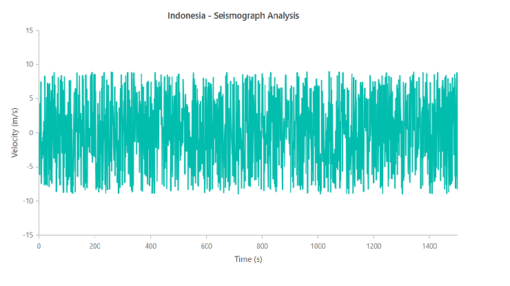
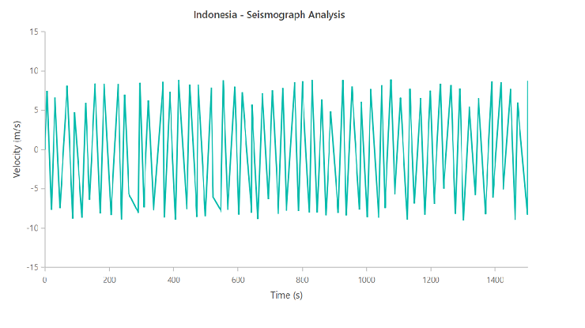

# How to down sample data in JavaScript Charts

Down sampling reduces the number of points rendered from a larger source dataset while preserving the overall visual shape. In this example, the source contains 2,000 points and the Largest-Triangle-Three-Buckets (LTTB) algorithm reduces the rendered dataset to approximately 400 representative points.

## Largest-Triangle-Three-Buckets algorithm

LTTB divides the source data into buckets and selects the point in each bucket that forms the largest triangle with representative points from the surrounding buckets. The selected points preserve prominent visual changes more effectively than uniformly skipping records.

The algorithm requires:

- The complete source array.
- A target point count, also called the threshold.
- The field mapped through `xName`.
- The field mapped through `yName`.

The target count must be at least `3` and less than the source-data length. If the target count is greater than or equal to the source length, return the original data instead of down sampling it.

> **Note:** LTTB is an application-level data-reduction technique. The Chart renders the array assigned to the series `dataSource`; the Chart does not automatically run the LTTB algorithm.

## Choose a target point count

A fixed threshold can be used when the Chart has a predictable width. For responsive Charts, calculate the threshold from the available pixel width so the rendered point density remains appropriate.

```javascript
var chartWidth = 800;
var targetPointCount = Math.max(3, Math.floor(chartWidth / 2));
var sampledData = largestTriangleThreeBuckets(
    originalData,
    targetPointCount,
    'x',
    'y'
);
```

A lower threshold improves rendering performance but removes more detail. A higher threshold preserves more detail but reduces the performance benefit. Validate the threshold against the dataset, Chart width, and required visual accuracy.

## Restore detail while zooming

Use the [`zoomComplete`](https://ej2.syncfusion.com/javascript/documentation/api/chart/chartmodel#zoomcomplete) event to update the series after a zoom operation. When the visible range becomes narrow enough, filter the original dataset to the visible X-axis range and assign those original points to the series. When the Chart returns to a wider range, apply LTTB again.

```javascript
zoomComplete: function (args) {
    var axis = args.axis;

    if (!axis || axis.name !== 'primaryXAxis') {
        return;
    }

    updateVisibleData(axis.actualRange, axis.zoomFactor, axis.zoomPosition);
}
```

Avoid switching to all original points based only on a hard-coded `zoomFactor`. Dataset size, Chart width, and the visible-range density should determine whether full-resolution or sampled data is appropriate.

## Complete example












## Before and after down sampling

### Before down sampling

The Chart renders all source points. This preserves the complete dataset but can increase rendering time and visual density.



### After down sampling

The Chart renders the reduced dataset produced by LTTB. The overall visual pattern is retained with fewer rendered points.



## Data integrity and performance considerations

- Keep the original dataset unchanged and store the sampled dataset separately.
- Preserve the first and last source points when applying LTTB.
- Ensure that X values are ordered consistently before down sampling.
- Do not apply LTTB independently to unsorted or unrelated series and assume their indexes remain aligned.
- Recalculate sampled data after the Chart width, source data, or target threshold changes.
- Debounce repeated zoom or resize updates when recalculation is expensive.
- Test whether down sampling hides short-duration spikes or outliers that are important to the use case.
- Perform large calculations outside frequent pointer-move handlers; consider a Web Worker when processing very large datasets.

## Troubleshooting

- If the sampled line is empty, verify that the target count is at least `3` and that the source contains more points than the target count.
- If the line contains invalid coordinates, verify that the `xName` and `yName` fields contain valid numeric or Date values supported by the axis.
- If zooming shows stale data, assign the updated array to the series and refresh the Chart after the zoom calculation completes.
- If the series shape changes unexpectedly, verify that the source data is ordered by X value before applying LTTB.
- If rendering remains slow, reduce the target point count and disable unnecessary markers, data labels, animations, and tooltips.
- If the comparison images do not render, verify that both image files exist relative to this documentation page.

## See also

- [Zooming](../zooming)
- [Working with data](../working-with-data)
- [Line series](../chart-types/line)
- [Chart events](../chart-events)
- [Getting started](../es5-getting-started)
