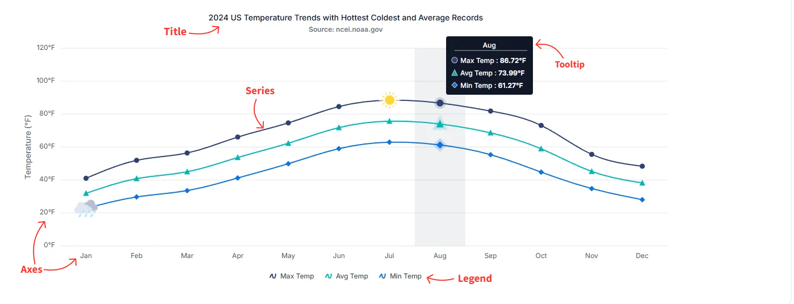

# Understanding JavaScript Charts

The JavaScript Chart control presents data through configurable structural and interactive elements. Structural elements such as the title, series, axes, chart area, and legend organize the visualization, while interactive elements such as tooltips, crosshairs, zooming, and selection help users inspect the data.

The following image identifies the primary elements of a Chart:

## Structural elements

### Title and subtitle

The Chart title identifies the subject or purpose of the visualization. A subtitle can provide supporting information such as a time range, data source, or explanatory note. Both elements support alignment, styling, positioning, and text formatting.

For configuration details, see [Title and subtitle](./title-subtitle).

### Series

A series represents a group of related data points. The series `dataSource` provides the data, while properties such as `xName` and `yName` map fields from each data object to the Chart axes. A Chart can contain one or more series and can combine supported series types such as Line, Column, and Area.

For configuration details, see [Chart series](./chart-series) and [Data binding](./data-binding/local-data).

### Axes

Axes define the scales and positions used to plot data. Cartesian Charts typically use an X-axis for independent values and a Y-axis for dependent values. Additional axes can be added when series require different scales or units.

The Chart supports numeric, category, DateTime, and logarithmic axes. Polar and radar Charts instead use angular and radial coordinate behavior.

For configuration details, see:

- [Numeric axis](./numeric-axis)
- [Category axis](./category-axis)
- [DateTime axis](./date-time-axis)
- [Logarithmic axis](./logarithmic-axis)
- [Multiple axes](./axis-customization#multiple-axis)
- [Polar and radar Charts](./polar-radar)

### Chart area

The chart area contains the plotted series and axes. Its background, border, and margins can be customized to match the application layout.

For configuration details, see [Chart appearance](./appearance).

### Legend

The legend identifies each series by its name, color, and shape. By default, selecting a legend item toggles the visibility of its corresponding series. This behavior can be disabled or customized through the legend settings.

For configuration details, see [Legend](./legend).

### Data labels and markers

Markers identify individual points in supported series, while data labels display point values or related text near the plotted points. Both elements can be styled and positioned independently.

For configuration details, see [Data labels](./data-labels) and [Markers](./data-markers).

## Interactive elements

### Tooltip

A tooltip displays contextual information when a user hovers over or interacts with a data point on a touch device. Tooltips are disabled by default and can be enabled and customized through the Chart tooltip settings.

For configuration details, see [Tooltip](./tool-tip).

### Crosshair and trackball

Crosshair and trackball features help locate and compare values near the pointer position. These features can display axis-level or point-level information without permanently adding labels to the Chart.

For configuration details, see [Crosshair and trackball](./cross-hair-and-track-ball).

### Zooming and panning

Zooming allows users to inspect a selected data range, while panning moves through a zoomed Chart. The interaction can be configured along the horizontal axis, vertical axis, or both axes.

For configuration details, see [Zooming](./zooming).

### Selection and highlighting

Selection identifies points, series, clusters, or regions for focused analysis. Highlighting visually emphasizes points or series during pointer interaction.

For configuration details, see [Selection](./selection).

## See also

- [Getting started](./es5-getting-started)
- [Chart series](./chart-series)
- [Axis customization](./axis-customization)
- [Title and subtitle](./title-subtitle)
- [Tooltip](./tool-tip)
- [Legend](./legend)