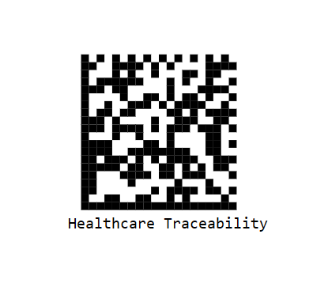

# Datamatrixgenerator in TypeScript Barcode control

## Data Matrix

DataMatrix Barcode is a two dimensional barcode that consists of a grid of dark and light dots or blocks forming square or rectangular symbol. The data encoded in the barcode can either be numbers or alphanumeric. They are widely used in printed media such as labels and letters. You can read it easily with the help of a barcode reader and mobile phones.

 







        


## Customizing the Barcode color

A page or printed media with barcode often appears colorful in the background and surrounding region with other contents. In such cases the barcode can also be customized to suit the needs. You can achieve this by using the forecolor property .

 







        


## Customizing the Barcode dimension

The dimension of the barcode can be changed using the height and width property of the barcodegenerator.

 







        


## GS1 Data Matrix

GS1 Data Matrix is a standardized Data Matrix barcode format that uses GS1 Application Identifiers (AIs) to encode structured business information such as product identifiers, batch numbers, expiration dates, and serial numbers.

The [`enableGS1`](https://ej2.syncfusion.com/javascript/documentation/api/barcode/barcodeGenerator/#enablegs1) property enables GS1-compliant Data Matrix barcode generation.

**Allowed Input Characters:** GS1 Data Matrix supports numeric, alphanumeric, and supported special characters. Data is encoded using GS1 Application Identifiers (AIs), enabling structured business information such as product identifiers, batch numbers, expiration dates, and serial numbers to be stored within a compact barcode.

The following example demonstrates how to generate a GS1 Data Matrix barcode:












>**Note**: The Barcode Generator validates the input data before generating the barcode. If the input data is invalid or cannot be encoded using the selected settings, the `invalid` event is triggered.

**Common Validation Errors**

| Error | Cause | Solution |
|---|---|---|
| Data too long | Exceeds symbol capacity | Reduce data or change encoding |
| Empty value | No data provided | Supply at least one character |
| Invalid encoding | Unsupported encoding mode | Use Auto, ASCII, ASCIINumeric, or Base256 |
| Invalid character for mode | Character not allowed in selected mode | Change encoding or data |












## Customizing the text

In barcode generators you can customize the barcode text by using the display text property .

 







        
