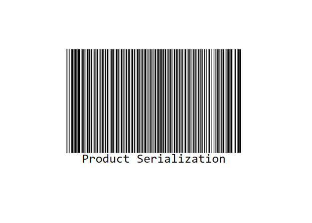
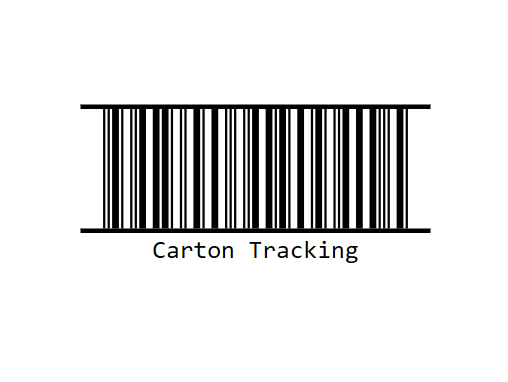
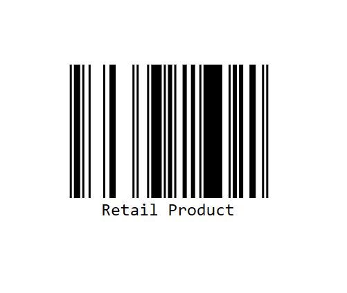
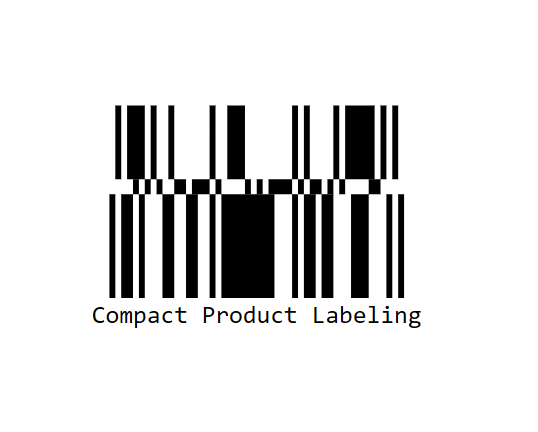
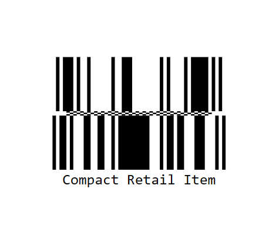
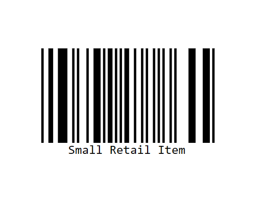
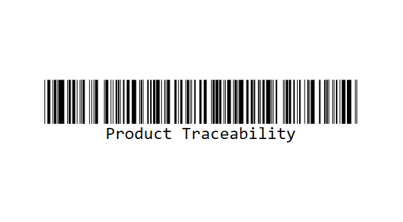
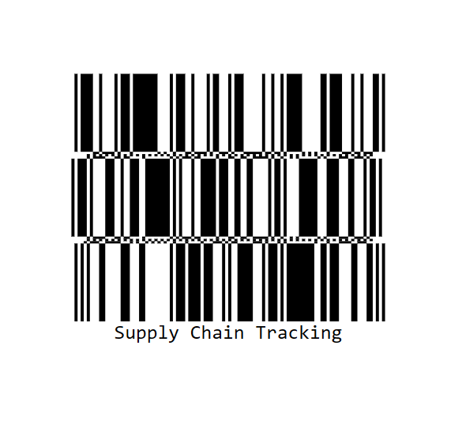

# GS1 Barcodes in EJ2 Barcode Generator

GS1 standards define a series of barcodes used for supply chain management, retail, and logistics operations. These barcodes encode product identification and tracking data using standardized GS1 Application Identifiers (AIs). The EJ2 Barcode Generator supports multiple GS1 barcode types to meet various industry requirements.

## GS1-Code128 Barcode

GS1-Code128 is a linear barcode based on Code 128 that uses GS1 Application Identifiers (AIs) to encode structured business data. It is commonly used in retail, logistics, health care, and supply-chain applications to store information such as product identifiers, batch numbers, expiration dates, and serial numbers.

**Allowed Input Characters:** GS1-128 supports numeric values (0-9), uppercase and lowercase alphabetic characters (A-Z, a-z), and supported ASCII special characters. Data should be encoded using valid GS1 Application Identifiers (AIs) to represent structured business information.












GS1-128 accepts GS1 Application Identifier (AI) data. The AI is enclosed in parentheses, followed by the data. Multiple AIs can be concatenated together.

**Common GS1 Application Identifiers**

| AI | Description |
|---|---|
| 00 | Serial Shipping Container Code (SSCC) |
| 01 | Global Trade Item Number (GTIN) |
| 10 | Batch or Lot Number |
| 11 | Production Date |
| 15 | Best Before Date |
| 17 | Expiration Date |
| 21 | Serial Number |
| 240 | Additional Product Identification |
| 400 | Customer Purchase Order Number |

## ITF-14 Barcode

ITF-14 (Interleaved 2 of 5) is the GS1 standard for encoding 14-digit Global Trade Item Numbers (GTINs) on outer cases and shipping cartons. The barcode automatically calculates and adds the GS1 mod-10 check digit. It is commonly used in logistics and warehouse management for tracking product cases.












**Allowed Input Characters:** ITF-14 supports numeric values (0-9) only and is used to encode a 14-digit GTIN (Global Trade Item Number). The final digit is automatically calculated as a check digit.

## GS1 DataBar Barcodes

GS1 DataBar is a family of linear barcode symbols designed for encoding GTIN data in retail and health care applications. These symbols provide a compact alternative to traditional linear barcodes while supporting reliable scanning and product identification.

### GS1 DataBar Omnidirectional

The GS1 DataBar Omnidirectional is a single-row barcode used to encode a 14-digit GTIN for retail product identification. It supports omnidirectional scanning, allowing the barcode to be read from any direction at the point of sale, making it suitable for consumer products and retail environments.

**Allowed Input Characters:** The GS1 DataBar Omnidirectional barcode encodes a 14-digit GS1 identification number designed for omnidirectional scanning. Accepted input includes numeric values (0-9) only, suitable for retail point-of-sale systems requiring multi-angle scanning capability.












### GS1 DataBar Stacked

The GS1 DataBar Stacked is a compact linear barcode that encodes a 14-digit Global Trade Item Number (GTIN) in a two-row stacked format. It is designed for retail and consumer products where label space is limited, providing efficient product identification while maintaining compatibility with point-of-sale systems. The stacked layout reduces the barcode width, making it suitable for small packages and labels.

**Allowed Input Characters:** GS1 DataBar Stacked supports numeric values (0-9) only and is used to encode a 14-digit GTIN (Global Trade Item Number). Its stacked format is designed for applications where horizontal space is limited while maintaining reliable scanning performance.












### GS1 DataBar Stacked Omnidirectional

The GS1 DataBar Stacked Omnidirectional is a two-row variant of the DataBar Omnidirectional. It provides omnidirectional scanning capability in a more compact vertical footprint, useful for items where horizontal space is limited.

**Allowed Input Characters:** GS1 DataBar Stacked Omnidirectional supports numeric values (0-9) only and is used to encode a 14-digit GTIN (Global Trade Item Number). It combines a compact stacked layout with omnidirectional scanning capabilities for retail environments where space is limited.












### GS1 DataBar Limited

The GS1 DataBar Limited barcode is a reduced-width symbol designed for small trade items where full-size EAN/UPC symbols cannot fit. It has the narrowest width among DataBar symbols, making it ideal for compact labeling applications.

**Allowed Input Characters:** GS1 DataBar Limited supports numeric values (0-9) only and is used to encode a 14-digit GTIN (Global Trade Item Number). It is designed for applications where space is limited while maintaining accurate product identification.












>**Note**: GS1 DataBar Limited has restrictions on valid GTIN values. The check digit must be in the range of 0-4 for restricted items.

### GS1 DataBar Expanded

The GS1 DataBar Expanded barcode supports multiple GS1 Application Identifiers (AIs), making it suitable for variable-measure products, coupons, and other applications that require additional data beyond a GTIN. It can encode up to 74 numeric or 41 alphanumeric characters.

**Allowed Input Characters:** GS1 DataBar Expanded supports GS1 Application Identifiers (AIs) and can encode numeric, alphanumeric, and supported special characters. It can store up to 74 numeric digits or 41 alphanumeric characters, enabling the encoding of detailed GS1-compliant data.












### GS1 DataBar Expanded Stacked

The GS1 DataBar Expanded Stacked is a multi-row variant of the GS1 DataBar Expanded. It provides the same multi-AI encoding capability while reducing horizontal space requirements by stacking multiple rows.

**Allowed Input Characters:** The GS1 DataBar Expanded Stacked barcode supports GS1 application identifiers (AIs) with alphanumeric data. It can encode up to 74 digits of numeric data or 41 characters of alphanumeric data with special characters for data separation using GS1 compliance standards.












## GS1 DataBar Validation

The GS1 barcode components include built-in validation to ensure data integrity. Invalid input will trigger the `invalid` event:












## Dynamic Property Updates

The GS1 Barcode components support real-time property binding. When you change any property value, the barcode automatically updates to reflect the changes. This is useful for creating interactive applications where users can customize the barcode appearance dynamically.

### Update GS1 Barcode Properties Dynamically

Here is an example showing how to dynamically update GS1 Barcode properties using event handlers:











